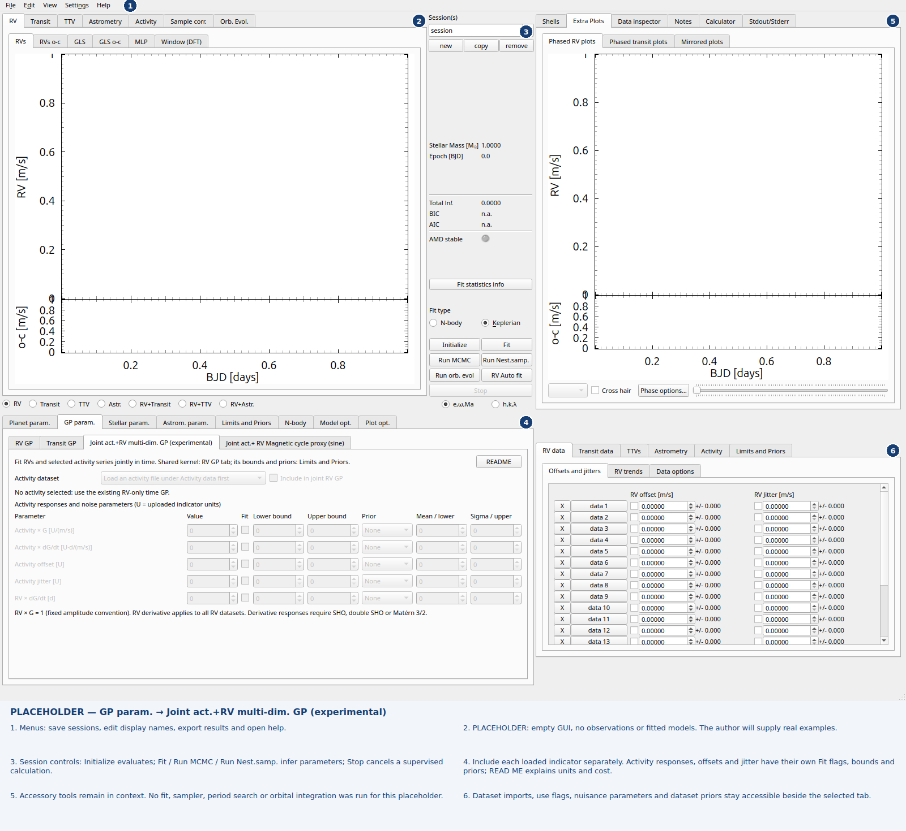
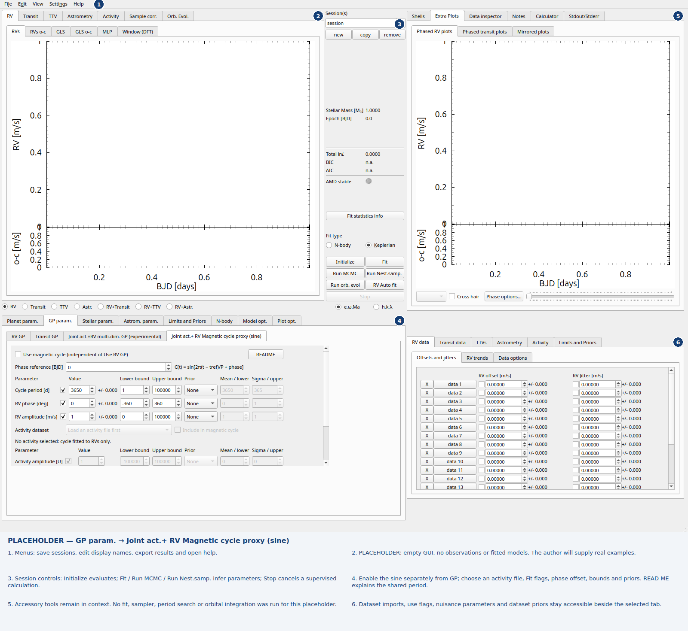

Activity indicators and Gaussian processes
==========================================

See :doc:`screenshots` for annotated full-window views of the relevant panels.

.. _activity:

Load activity indicators under **Activity**, inspect their time series and GLS,
and compare period/phase against RV residuals. Correlation analysis must compare
matching observations and account for instrument offsets; a correlation alone
does not establish causation. The activity helper window offers its own
processing/search controls; main-window Stop does not supervise every helper.

Activity plot controls
----------------------

Use **Go to plot options** below the activity time series to open
**Plot opt. → Activity**. Each dataset has the same **Size**, **Alpha** (0–255),
**Symbol** and **Color** controls as RV and transit datasets, using the same
color dialog and symbol picker. Error bars use the dataset color and alpha.
The rows follow the activity dataset slots. **All symbol sizes** updates every
row; **Model width** and **Model color** control the overlaid activity model.
Dataset styles are retained in the session and remain adjustable during fitting.

The time-series **o-c** checkbox subtracts the initialized/fitted activity mean
(including its offset, magnetic cycle and/or joint GP). Without an applicable
model, it subtracts the mean of the uploaded values. Error bars remain the
measurement uncertainties. The **GLS** view has an independent **o-c** checkbox:
check it to compute the periodogram of those same residuals, or leave it unchecked
for the uploaded measurements. Reinitializing or fitting refreshes a displayed
residual periodogram when the model changes. These controls only change the
plots; the observations used for fitting remain unchanged.

The time-series **Cross hair** checkbox uses the same cursor overlay as the RV
plots; **Legend** shows the selected dataset name and the model curve when
present. In **Correlations**, use **Go to plot options** to reach the correlation
axis-label, color, error-bar and fitted-correlation controls under
**Plot opt. → Activity**. The correlation plot has its own **Cross hair** checkbox.

Use **Edit → Edit file names → Activity** to change an imported activity
dataset's display name. Applying the change updates the import button, activity
time-series and GLS selectors, legend, GP/cycle selectors and correlation
selectors, retaining the current correlation pair and fitting data. The original
uploaded copy also receives the display name so helper resets retain it.

Gaussian processes
------------------

A GP represents correlated residual variability alongside the deterministic
model. **GP param. → RV GP / Transit GP** separates RV and photometry. Enable the
process, select a kernel, choose its free parameters, and set bounds/priors.
Enter physical values displayed by the interface, not their logarithms.
Internally positive parameters may be logged by celerite. Periods/time scales
are in days; RV and flux amplitudes have their respective data units.

.. list-table:: Kernel conventions
   :header-rows: 1
   :widths: 25 75

   * - Kernel
     - Parameters
   * - SHO
     - Positive S0 spectral-density scale, Q quality factor, omega angular frequency (radians/day); 2*pi/omega is the characteristic period.
   * - Double SHO
     - sigma standard deviation, P primary period, Q0, dQ and relative secondary power f. The modes are near P and P/2; the dummy slot is not physical.
   * - Rotation
     - Positive covariance amplitude, decay time, period and relative non-oscillatory factor.
   * - Matérn 3/2
     - Positive sigma and rho (correlation time), plus the celerite approximation parameter eps.
   * - DRW / RealTerm
     - Positive covariance amplitude a and inverse decay time c: covariance = a exp(-c abs(delta t)).

GUI labels show units in both parameter and bounds/prior panels. ``[1]`` means
dimensionless. Let Y denote m/s for RV or the supplied photometric flux units
for transit GPs (normalized relative flux is dimensionless).

.. list-table:: GP parameter units
   :header-rows: 1
   :widths: 65 35

   * - Parameter
     - Units
   * - SHO S0
     - Y² d; variance = S0 omega0 Q
   * - SHO omega0
     - rad/d
   * - SHO Q; double-SHO Q0, dQ, f; Rotation factor
     - Dimensionless [1]
   * - Double-SHO sigma; Matérn sigma
     - Y
   * - Double-SHO P; Rotation period/decay time; Matérn rho
     - d
   * - Rotation covariance amplitude; DRW a
     - Y²
   * - DRW c; Matérn eps
     - d⁻¹

The implemented celerite Matérn approximation uses ``eps * time_lag`` in its
oscillatory term: eps therefore has inverse-time units. Bounds, Gaussian
means/standard deviations and Jeffreys endpoints share their parameter's units.
The joint-activity form uses U for each uploaded indicator's own units.

Fit a deterministic baseline first, choose physically plausible starting values
and bounds, enable the GP, and compare residuals. Jitter describes uncorrelated
noise and can correlate with GP amplitude and planetary parameters. Check
posterior degeneracies and the effect of kernel choice. Linking a photometric
GP to an RV GP does not make their amplitude units interchangeable.
GP configurations use the supported legacy/SciPy inference path rather than
the native Gaussian-only joint optimizer. The **READ ME** buttons provide
offline guidance and backend citations.

.. _joint-activity-gp:

Joint RV and activity inference
-------------------------------

The joint model lets BIS, FWHM, Hα, NaD1, dLW or other loaded indicators constrain
stellar variability in the RVs. **Time remains the input coordinate.** The
indicators are additional observations of a shared stochastic process, rather
than replacement coordinates for time. All selected series and RV residuals
are evaluated together during optimization, MCMC or nested sampling. This is
not a preliminary activity-only fit whose curve is subsequently copied into RV.

Selecting several indicators
~~~~~~~~~~~~~~~~~~~~~~~~~~~~

1. Load RV data and activity files through their respective data panels. Activity
   files contain time, value and measurement uncertainty. Use a consistent time
   system and finite values with positive uncertainties. Unequal timestamps and
   sampling are supported; matching or interpolating observations is unnecessary.
2. Open **GP param. → RV GP**, enable **Use RV GP**, and choose the kernel and
   its existing parameter values, bounds and priors.
3. Click **Select activity indicators…**, or open **Joint activity GP** directly.
   Choose a loaded file and check **Include in joint RV GP**. Repeat for each
   indicator. The summary lists every included series.
4. Review that indicator's response, offset, bounds and priors. Changing the
   dataset selector displays another indicator's settings; it does not deselect
   the previously included series.
5. Press **Initialize** to evaluate the model, then **Fit**, **Run MCMC** or
   **Run Nest.samp.** as appropriate. Inspect predictions, residuals and posterior
   correlations before interpreting a planetary signal.

The default tab order is **RV GP → Transit GP → Joint activity GP**; drag the
tabs to rearrange them. The **README** button at the top right of Joint activity
GP opens an offline guide to this model and its parameters. Its response form is
a direct Designer ``QGridLayout`` named ``activity_gp_parameters_grid``.

With no activity selected, the existing RV-only time GP is used. Disabling
**Use RV GP** switches off joint conditioning while preserving the selections.
The **Include** checkbox controls participation in the likelihood; a parameter's
**Fit** checkbox only controls whether its value is allowed to vary.

.. _activity-gp-screenshot:

   Empty GUI placeholder, awaiting a real example supplied by the author.
   The selector and inclusion controls appear in their unloaded state; no
   activity observations, fitted response values or predictions are invented.
   The numbered annotations retain the complete window context.

What the additional parameters mean
~~~~~~~~~~~~~~~~~~~~~~~~~~~~~~~~~~~

Let :math:`G(t)` denote the common activity process and
:math:`\dot G(t)=dG/dt` its time derivative. In addition to the deterministic RV
model and instrument offsets, the activity contributions are

.. math::

   v_{\mathrm{activity}}(t) &= G(t) + b_{\mathrm{RV}}\dot G(t), \\
   I_j(t) &= c_j + a_jG(t) + b_j\dot G(t) + \epsilon_j(t), \\
   \operatorname{Var}(\epsilon_j) &= \sigma_j^2 + s_j^2.

The existing RV kernel parameters describe the amplitude and time dependence
of :math:`G`: for example, its characteristic period and coherence time. They
retain their existing kernel-specific conventions and priors. The new response
parameters describe how that common process appears in each observable.
Indicators have different units, baselines, amplitudes and possibly signs; they
cannot generally share an identical numerical curve.

.. list-table:: Responses and noise for the displayed activity dataset
   :header-rows: 1
   :widths: 22 53 25

   * - GUI row
     - Meaning and units
     - Initial setting
   * - Activity × G
     - Signed coefficient :math:`a_j`, converting the process into this indicator's units U; units U/(m/s).
     - Scatter-based guess; Fit on.
   * - Activity × dG/dt
     - Optional coefficient :math:`b_j`, allowing sensitivity to the rate of change and a different response shape; units U day/(m/s).
     - Zero; Fit off.
   * - Activity offset
     - Baseline :math:`c_j`, because the GP itself has zero mean; units U.
     - Median of this series; Fit on.
   * - Activity jitter
     - Extra uncorrelated scatter :math:`s_j`, added in quadrature to measurement errors; units U.
     - Zero; Fit off.
   * - RV × dG/dt [d]
     - One shared coefficient :math:`b_{\mathrm{RV}}` for all RV instruments; units days. This is the same parameter whichever indicator is displayed.
     - Zero; Fit off.

The RV coefficient multiplying :math:`G` is fixed to **one**. This anchors the
common amplitude to the RV kernel convention and avoids a redundant scaling
between the kernel amplitude and every response. Existing per-instrument RV
offsets and jitters remain in use. Activity offsets and jitters are separate.

The initial response is only a guess, not a calibrated conversion. A negative
response is allowed for an anticorrelated indicator. Derivatives are optional:
start with direct responses and offsets, then add derivative responses or jitter
when the data and physical model justify them. Fixing a parameter retains its
current contribution to the model; it does not remove that contribution.

Each row provides a value, **Fit** flag, bounds and prior. The final two fields
mean Gaussian mean/standard deviation or Jeffreys lower/upper support, according
to the selected prior family. Signed coefficients usually need uniform bounds
or a Gaussian prior; Jeffreys support must be strictly positive. Settings and
returned uncertainties are stored in the session, not global plot preferences.

Which kernels can be used?
~~~~~~~~~~~~~~~~~~~~~~~~~~

All five existing RV kernels support the joint direct-response model. The
extra restriction concerns derivatives, not inclusion of activity data.

.. list-table:: Joint-kernel compatibility
   :header-rows: 1
   :widths: 40 30 30

   * - Kernel
     - Direct response to G
     - Response to dG/dt
   * - SHO
     - Yes
     - Yes
   * - Double SHO
     - Yes
     - Yes
   * - Matérn 3/2 (existing approximation)
     - Yes
     - Yes
   * - Rotation
     - Yes
     - No
   * - DRW / RealTerm
     - Yes
     - No

Rotation and RealTerm contain exponential terms with a cusp at zero lag, so the
required process derivative is not defined in the mean-square sense. With
these kernels, **every derivative value must be zero and its Fit box unchecked**,
including the shared RV derivative. The GUI grays out these rows and uses zero
fixed derivatives, retaining previous values, Fit flags, bounds and priors for
restoration when you switch back to a compatible kernel. For Python/API use, an
unchecked but nonzero derivative still enters the model and is invalid. You can still fit several indicators
simultaneously with either kernel using their direct responses and offsets.

How many extra free parameters?
~~~~~~~~~~~~~~~~~~~~~~~~~~~~~~~

Only checked **Fit** boxes add dimensions. With three included indicators
(NaD1, dLW and Hα), fitting only each direct response and offset adds
**six free parameters**: two per indicator. Derivative and jitter rows left
fixed add no free parameters. The kernel and orbital parameters already present
are additional to those six.

For :math:`M` included indicators, fitting all four per-indicator rows and the
one shared RV derivative adds :math:`4M+1` free parameters. For three indicators
that is thirteen. These extra response parameters are needed to express
different observables; the optional derivative and jitter parameters need not
be fitted. A response or offset can also be fixed if independently known.

There are two separate computational costs:

* More free parameters usually require more likelihood evaluations and make
  posterior exploration harder when parameters are correlated.
* More selected observations enlarge the covariance even if every new response
  parameter is fixed. The current joint backend uses a dense covariance for
  :math:`N=N_{\mathrm{RV}}+\sum_jN_j` observations, with approximately
  :math:`O(N^2)` memory and :math:`O(N^3)` factorization time. Different observables
  measured at the same epoch still count as different observations. Doubling N
  therefore means roughly four times the covariance memory and eight times
  the factorization work.

The joint covariance is constructed in Python from the existing celerite
kernel coefficients. It includes correlations between the selected series;
it is not a sum of independent GP fits. This implementation does not use
celerite's fast solver for the joint block. With no activity selected, the
existing fast RV-only celerite path remains available. No Fortran changes are
required for this joint-GP feature.

Priors, reported likelihood and plots
~~~~~~~~~~~~~~~~~~~~~~~~~~~~~~~~~~~~~

SciPy optimization, MCMC and nested sampling share the Python joint likelihood.
With priors enabled, SciPy optimizes the posterior (MAP); MCMC samples the
posterior, and nested sampling uses the data likelihood with its prior transform.
**Reported lnL is the data log likelihood, excluding the prior density.** It
includes the selected activity observations as well as the other selected data
components. The RV statistics row represents the joint RV–activity block,
including its activity observation count and covariance-weighted chi-square.
It is not an independent RV-only likelihood once joint activity is enabled.

Activity uploads automatically populate the time-series and GLS views; selectors
show filenames and disable empty slots. After initialization or fitting, each
included indicator's time-series plot overlays its smooth conditional GP mean
in the selected model color. RV predictions also condition on all selected indicators. These curves
are predictions at the current parameter values, not posterior-averaged curves
or uncertainty bands. An indicator that has not been included and initialized
has no joint GP curve. The activity GLS shows uploaded measurements by default;
check its **o-c** box to inspect model-subtracted residuals (or residuals about
the data mean when no model is available).

A shared-process interpretation is a modeling assumption. Compare fits with
and without indicators, inspect remaining structure and parameter correlations,
and check sensitivity to kernel choice and priors. A successful synthetic
example alone does not demonstrate separation of planets and stellar activity
in real observations.

.. _magnetic-cycle:

A shared magnetic cycle alongside the GP
----------------------------------------

Open **GP param. → Joint act.+ RV Magnetic cycle proxy (sine)**. This is a deterministic
Exo-Striker mean model, outside celerite, and does not occupy a planet slot.
There is no corresponding Transit GP component. Enable **Use magnetic cycle**
independently of **Use RV GP**; both may be enabled simultaneously.

The common waveform is ``C(t) = sin[2*pi*(t-tref)/P + phase]``. Its period P
(days) is shared. **RV phase [deg]** is measured at the fixed reference epoch
tref in BJD. Each activity index has a **Phase offset [deg]** relative to the RV
phase, so its waveform uses ``RV phase + phase offset_j``. Check **Fit** on that
row to decouple its phase from the RVs; different indices may have different
offsets. The default is zero with Fit unchecked and bounds [-180, 180] degrees,
preserving existing sessions until you enable this freedom.
RVs have their own semi-amplitude in m/s; each selected activity indicator has
a separate signed semi-amplitude in its uploaded units U. Negative indicator
amplitudes permit anticorrelation. The reference defaults to the first RV time
and is independent of the orbital epoch. Changing it changes the phase convention.

Choose a loaded activity file, check **Include in magnetic cycle**, and repeat
for other indices. These selections are independent of **Joint activity GP**:

.. list-table:: Example of separate activity selections
   :header-rows: 1

   * - Component
     - RVs
     - FWHM
     - BIS and Hα
   * - Magnetic-cycle sine
     - Included
     - Included
     - Not included
   * - Joint rotational GP (for example dSHO)
     - Included
     - Not included
     - Included

An indicator may also participate in both components. Its cycle mean is then
subtracted before GP conditioning; its offset and jitter are shared between the
two forms, and its observations enter the likelihood once. Its displayed mean
contains both contributions. The RV deterministic curve includes the sine, and
RV residuals subtract it. Initialize/Fit refreshes the activity-model curve.

The form places each Fit checkbox before its value, followed by an
uncertainty label and bounds/prior settings. Errors use ``+/- 0.000`` formatting, showing the larger absolute lower/upper
error as in the planet fields. Nonzero errors below 0.0005 use scientific notation so small indicator
uncertainties remain visible. Activity numeric fields retain small values,
including RHK-prime-scale amplitudes, offsets, jitters and priors.
Stored errors retain full precision. The display reads the
stored inference errors, including SciPy uncertainties when available, as well
as MCMC and nested-sampling results. Scroll within the panel to reach the indicator's
amplitude, phase offset, offset and jitter if the window is small. The fixed reference epoch
has no Fit flag. The default period is the larger of 3650 days and twice the RV
span; amplitudes are scatter-based guesses. Review them and choose meaningful
bounds before fitting. The component starts disabled in new and older sessions.
Settings and returned uncertainties are saved in the session.

Optimization uses the Python/SciPy likelihood for an enabled cycle, including
when the main Fit button normally uses Fortran. MCMC and nested sampling use the
same complete model. Reported lnL excludes prior density, and statistics count
the union of cycle and GP activity observations. Cycle-only indices have
independent Gaussian noise; GP-selected indices retain the joint covariance.

   Empty GUI placeholder, awaiting an author-provided real magnetic-cycle
   example. Default controls are shown without activity observations or an
   invented fitted model. Small windows use the panel's vertical scrollbar.

A single coherent sine assumes a stable waveform; fitted activity phase offsets
leave only the period shared. Negative amplitudes and a 180-degree phase change
describe the same signal. When fitting a full-circle phase offset, use
nonnegative activity-amplitude bounds to avoid duplicate solutions. Phases are
periodic: -180 and +180 degrees are equivalent. These offsets do not uniquely
establish a physical time delay. The model does not include harmonics or
evolving cycle shapes. With less than a full observed cycle, period and
amplitude can be poorly constrained and degenerate with RV trends or long-period
planets. Inspect posterior correlations and compare alternative models.
