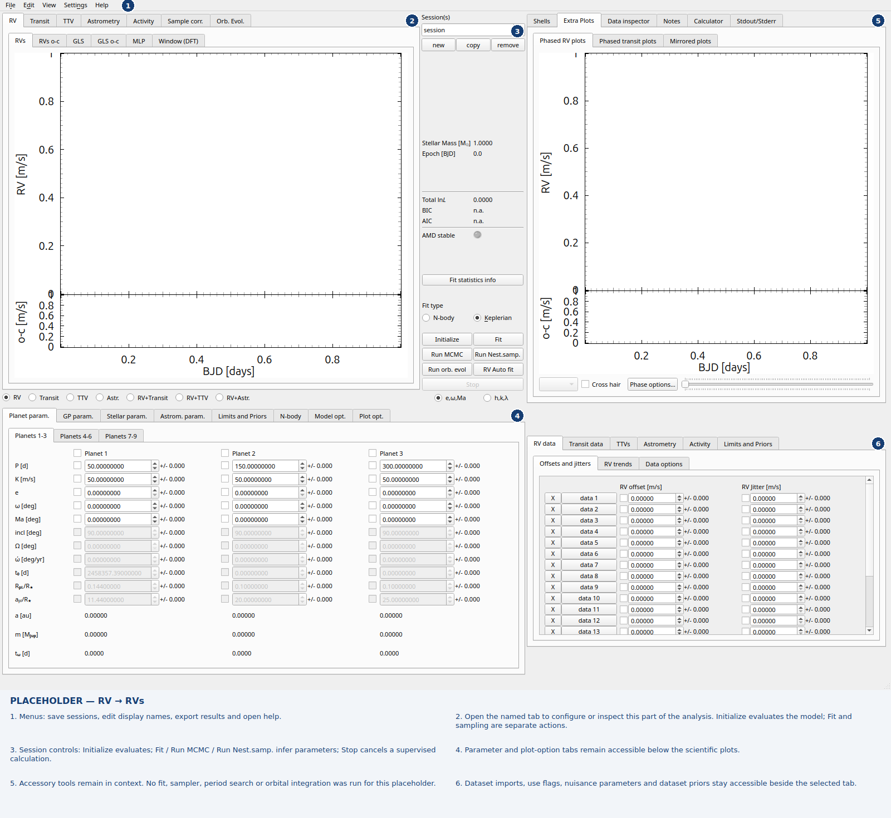

GUI layout and controls
=======================

.. _gui:

   Empty GUI placeholder, rendered directly by Qt. Real examples will be supplied
   by the author. Click an image to inspect it
   at its original resolution.

The numbered regions are: **1** menu bar; **2** scientific plots; **3** sessions,
statistics, and calculation controls; **4** physical parameters and model/plot
options; **5** accessories and consoles; **6** datasets and their noise models.
The horizontal selector between plots and parameters chooses the fitted data
combination. Selecting a plot tab does not enable that data in the likelihood.

Session and calculation panel (3)
---------------------------------

The session dropdown selects the active analysis. **new**, **copy**, and
**remove** create, duplicate, and remove sessions; save comparisons as a multi
session before discarding them. Stellar mass and epoch identify the displayed
model. **Total lnL**, **AIC**, and **BIC** summarize the selected data likelihood;
**Fit statistics info** exposes the breakdown. Compare information criteria only
for fits to the same observations with compatible likelihood normalization.
An unavailable statistic is displayed as such. **AMD stable** is a diagnostic,
not a substitute for a long integration.

**Keplerian** models independent orbits; **N-body** includes planet interactions.
The radio buttons **RV**, **Transit**, **TTV**, **Astr.**, **RV+Transit**,
**RV+TTV**, and **RV+Astr.** select the analysis combination. Configure the
individual dataset enable flags too. **e,omega,Ma** and **h,k,lambda** select
the orbital parameterization; check the parameterization page before changing
coordinates in a saved analysis.

* **Initialize** evaluates the starting configuration and updates model displays.
* **Fit** runs the selected optimizer and stages with the checked free parameters.
* **Run MCMC** and **Run Nest.samp.** explore parameter distributions using the
  settings and priors in **Model opt.**.
* **Run orb. evol** integrates the system with the **N-body** settings.
* **RV Auto fit** performs an automated RV planet search; inspect aliases and
  activity before accepting a candidate.
* **Stop** cancels a supervised main-window job after confirmation and returns
  to its starting session. Partial fits, chains, and orbital histories are
  discarded. Files already written by a backend are not rolled back. Separate
  detrending/activity helper calculations and synchronous auto searches are
  outside this main-window cancellation mechanism.

During a supervised calculation, competing actions and parameter/session edits
are locked. Progress appears in the status bar and **Stdout/Stderr**. Stop remains
available until subprocess cleanup finishes.

Physical parameters (4)
-----------------------

**Planet param.** provides nine planet slots in groups of three. The planet's
checkbox includes that planet; parameter checkboxes select free coordinates.
An unchecked parameter is held fixed at its entered value. Grey controls depend
on model/data selection. The displayed +/- errors depend on the uncertainty
method and are not automatically posterior credible intervals.

.. list-table:: Orbital and transit parameters
   :header-rows: 1
   :widths: 25 75

   * - Field
     - Meaning and units
   * - P; K
     - Period in days; stellar RV semi-amplitude in m/s.
   * - e; omega
     - Eccentricity; argument of periastron in degrees.
   * - Ma (M0)
     - Mean anomaly in degrees at the shared element epoch.
   * - Incl; Omega
     - Inclination and longitude of ascending node in degrees; important for dynamical/astrometric geometry.
   * - omega dot
     - Apsidal precession in degrees/year when the selected backend supports it.
   * - t0
     - Mid-transit epoch in days using the input time standard.
   * - Rp/Rstar
     - Planet-to-star radius ratio, dimensionless.
   * - ap/Rstar; density mode
     - Scaled semimajor axis or the selected shared stellar-density coordinate; follow the displayed parameterization.
   * - a; m; t peri
     - Derived semimajor axis (au), mass (Jupiter masses), and periastron time (days). RV-only masses depend on inclination.

**GP param.** separates RV and photometric processes. SHO, double SHO, rotation,
Matérn 3/2, and DRW kernels have different amplitudes and time scales; use the
**READ ME** help and :doc:`activity`. **Stellar param.** holds mass, radius,
luminosity, temperature and associated stellar inputs, plus an RV scatter
calculator. **Astrom. param.** holds the absolute-astrometry coordinates and
nuisance parameters; distinguish reference-epoch quantities from orbital elements.

**Limits and Priors** on the left sets planetary, stellar, astrometric and GP
bounds/priors. The right-hand tab of the same name covers dataset offsets,
jitters, trends, limb darkening and dilution. Hard bounds restrict the allowed
space. Gaussian priors require a mean and positive sigma; Jeffreys priors need
positive ordered limits. Choose one prior family for a coordinate. Sampling
with inappropriate bounds can suppress valid solutions or admit unphysical ones.

Model options (4)
-----------------

**Model opt. → Models → RV Model** controls the epoch (including the **first RV**
choice), model grid, integration precision/time step, time limits, coplanar
inclinations and shared jitter options. One shared orbital epoch is needed for
joint physical models. More plot points improve display sampling, not integration
accuracy. Test a smaller dynamical time step before trusting a timing solution.

**Fortran opt. (RV / Transit / TTV)** configures primary/secondary LM or Simplex
stages and their run counts; zero runs skips a stage. The current joint Fortran
optimizer maximizes normalized Gaussian likelihood for supported RV, photometry,
timing and enabled duration/depth combinations. Its capabilities are broader
than some older RV-only tooltip wording. The LM and Simplex sub-tabs expose
iteration/evaluation budgets, tolerances and step controls; see
:doc:`fortran-optimization` for the defaults and their session persistence. Unsupported GP/astrometry/GR/precession
and other model combinations use the SciPy path in the GUI. See :doc:`rvtran`.

**SciPyOp opt.** exposes Nelder–Mead, TNC, Powell, CG, BFGS, Newton-CG, L-BFGS-B,
and SLSQP controls, stage counts and tolerances. Select a method appropriate to
bounds and differentiability. **Estimate parameter uncertainties (numerical
Hessian)** adds local curvature errors after fitting; it is off by default and
can require many model evaluations. Inspect its status before using errors.

**Parameterisation** chooses alternative orbital/transit coordinates and shared
physical constraints. **GLS/MLP/TLS opt.** sets search ranges, frequency sampling,
and search controls. **MCMC opt.** sets walkers, steps, initialization,
burn-in, thinning and parallel execution. **Nest. Samp. opt.** controls the
nested sampler, live points, stopping and sampling strategy. **Auto fit opt.**
sets automated-search limits and significance settings. Those searches nominate
candidates; significance thresholds do not establish a planet's physical origin.

**N-body** has general integration settings, an arbitrary-configuration test,
and posterior-sample integration. Set the integrator, span, step and output
cadence before running. Detailed interpretation is in :doc:`stability`.

Plots and plot options (2, 4)
-----------------------------

The left plots show **RV** time series/residuals, GLS/GLS o-c/MLP/window spectra;
**Transit** time series/residuals and TLS searches; **TTV** timings and durations;
**Astrometry** absolute and imaging views; **Activity** time series, GLS and
correlations; **Sample corr.** posterior relations; and **Orb. Evol.** orbital
elements, orbital view and resonance angles.

Drag to pan, scroll to zoom, and use the plot's **A** button or **View all** to
restore its range. The right-click menu provides axis/mouse options and export.
**Plot opt.** separates axes, RV, transit, TTV, astrometry, activity, periodograms,
data inspector, N-body and cornerplot styles. The Activity page uses the same
Size/Alpha/Symbol/Color controls as RV/transit and holds the correlation controls.
Activity time-series and GLS o-c boxes select model/mean residuals; crosshairs,
legends and Go to plot options shortcuts are available. See :doc:`activity`.
Axis labels, colors, marker/line
visibility, sizes, opacity, range and hold controls change presentation.
N-body styling redraws saved integration data without repeating the integration;
per-planet color overrides apply to that plot. Pair selectors and angle folding
change which orbital relationship is displayed.

Data panel (6)
--------------

**RV data** supplies import/remove buttons, independent instrumental offsets and
jitters, RV trends and data options. **Transit data** has flux offsets/jitters,
linear/quadratic baseline trends, limb-darkening laws/grouping, dilution and
per-dataset options such as detrending. Keep different instruments/passbands in
separate slots unless sharing is justified. Both support up to 60 slots in the
current joint backend; scrolling exposes further rows.

**TTVs** assigns timing files to planets and enables measured components.
**Astrometry** separates **Hipparcos/Gaia** and **Imaging** inputs. **Activity**
loads indicators and opens their analysis controls. The right-hand **Limits and
Priors** controls the associated nuisance parameters. See the corresponding
workflow chapters for file formats and conventions.

Accessories (5)
---------------

**Shells** contains the embedded Jupyter console, pyqtgraph console, and optional
AI chat when its dependency is available. Python changes are programmatic edits:
check the active object and use **Edit → push Jupyter var. to GUI** to publish the
intended fit. **Extra Plots → Phased RV plots** separates planetary signals;
**Mirrored plots** copies a selected scientific plot, with its styles and axes,
without recomputing it. **Cross hair** reads coordinates; **to the Org. Plot**
opens its source. Mirror zoom/export operates independently.

**Data inspector** displays selected dataset values; **Notes** stores analysis
notes; **Calculator** provides numerical scratch work; **Stdout/Stderr** records
progress, errors and diagnostic output. These are useful when a result is absent
or a fit stops early.

Menu bar (1)
------------

* **File** creates/opens/saves single and multi sessions, imports supported
  external RV formats, edits dataset names and quits. Save explicitly before
  replacing a session. Legacy RVmod init and RVBank/MAROON-X imports depend on
  those formats; they are not generic three-column text importers.
* **Edit** includes publishing a Jupyter variable and RV Auto fit. Controls
  explicitly marked developer/work-in-progress should not be treated as a
  supported scientific workflow.
* **View** prints the GUI window, exposes F-test diagnostics, exports parameter
  and prior LaTeX tables, RV/transit data/models and orbital histories, collects
  plots, and opens the confidence-interval reference table. Some export actions
  prepare Python commands: inspect the console, set the destination, and execute
  the command. GUI screenshots differ from publication-quality plot exports.
* **Settings** selects widget style and GUI/plot fonts. Platform styles may differ
  from these Fusion screenshots.
* **Help** opens the repository and credits; offline READ ME buttons explain
  individual modeling tools. Record the versions of scientific dependencies used.

The :doc:`screenshots` walkthrough provides four annotated full-window views
with different tabs open.

Parameterization details
------------------------

The h/k coordinates are ``h = e sin(omega)`` and ``k = e cos(omega)``;
lambda is the mean-longitude coordinate. They use eccentricity itself, rather
than its square root. Their individually allowed widget ranges do not imply
that every rectangular h/k combination is a bound orbit. Check physical bounds
and how a prior transforms when changing coordinates.

The density option displays stellar density in **kg/m³**, replacing individual
scaled axes where supported. **Semi-amplitude K / Pl. mass.**, **Ma / t omega**,
and **Use photo-dynamical model** change the interpretation/model settings;
verify which are active for the selected backend before reusing a parameter
vector. **Sort planets by period** moves enabled planets' parameters, bounds,
priors and dataset assignments together. After sorting, use the updated planet
slots when assigning timing datasets or reading sampled-column metadata.

Updated views and QSO mode
--------------------------

See :doc:`whats-new` for recent functionality and :doc:`tab-gallery` for empty
full-window placeholders with each accessible tab open. The author will supply
real screenshots to replace them. **Edit → Edit file names** includes activity
dataset display names. **Print info** windows retain manual resizing.

The ``-QSO`` launch hides exoplanet-only stellar-activity, magnetic-cycle,
transit and astrometric entry points while retaining shared test-data plot
controls. See :doc:`qso-mode`.
