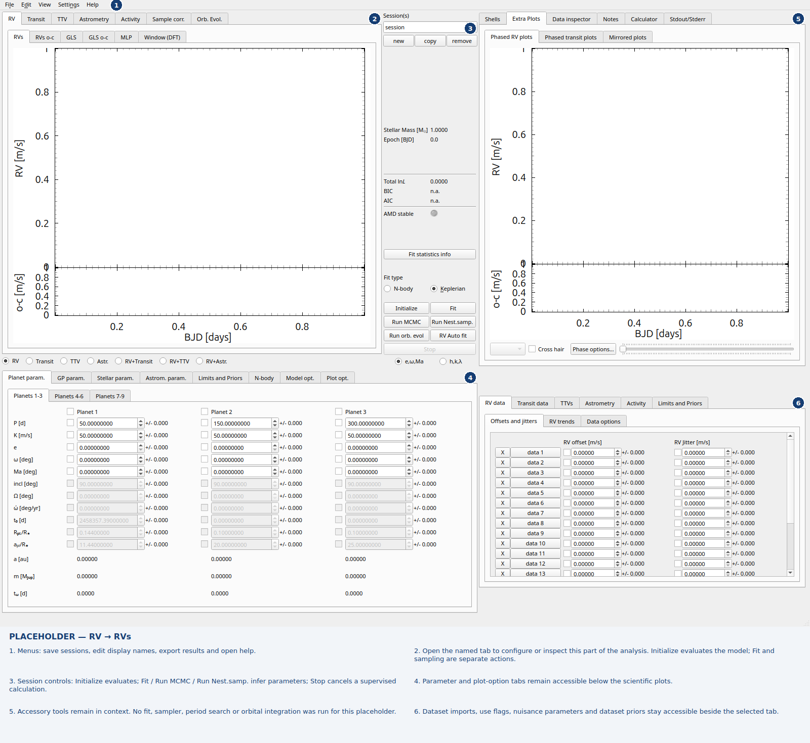

Exo-Striker user and API manual
===============================

Exo-Striker combines radial velocities, transit photometry, transit timings,
astrometry, stellar activity diagnostics, and orbital dynamics in one interactive
application. This manual describes the **local source checkout reviewed on
11 November 2026**, whose package version is **0.97.1**. Development features may
precede the release distributed on PyPI. Record your source revision alongside
saved sessions and published results.

Start with :doc:`installation`, then :doc:`quickstart` and :doc:`gui`.
:doc:`api` explains the Python interface without requiring a GUI.

   Empty GUI placeholder, awaiting a real example supplied by the author.
   Numbered regions are explained in :doc:`gui`; see :doc:`screenshots` for other open-tab combinations.

.. toctree::
   :maxdepth: 2
   :caption: Getting started

   installation
   quickstart
   gui
   whats-new
   screenshots
   tab-gallery
   qso-mode
   helper-windows

.. toctree::
   :maxdepth: 2
   :caption: Analysis workflows

   rvs
   transit
   rvtran
   timing-astrometry
   activity
   otbfpu
   fortran-optimization
   stability

.. toctree::
   :maxdepth: 2
   :caption: Python and maintenance

   api
   tutorials2
   troubleshooting
   documentation
   credits
