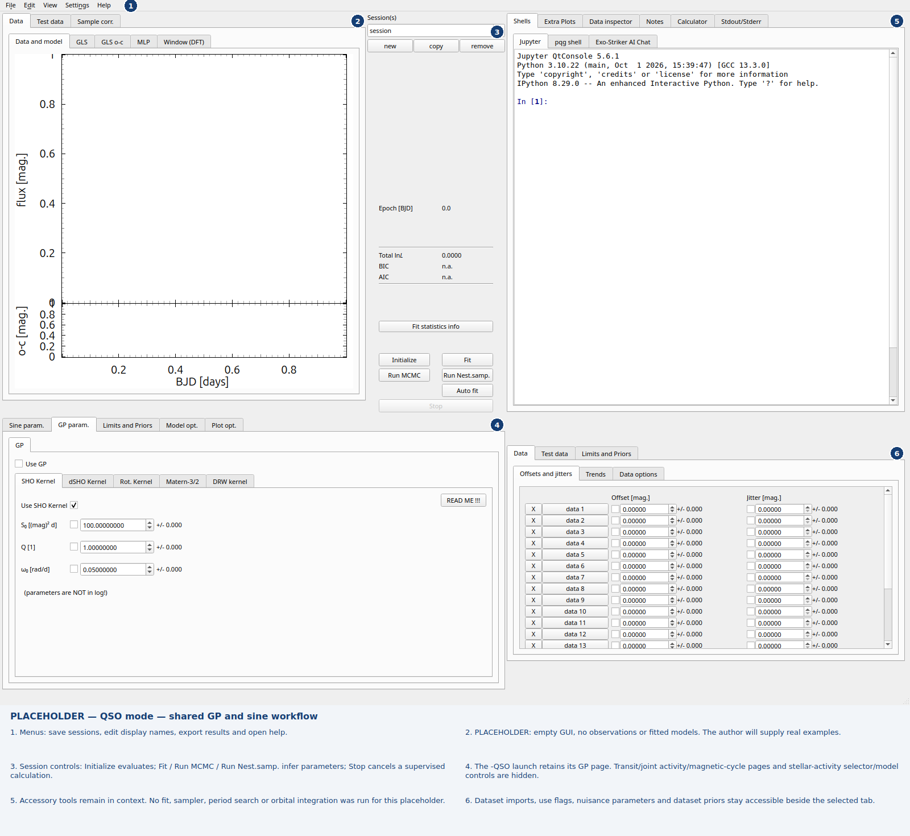

QSO mode
========

Launch the shared application in quasar mode::

   python -m exostriker -QSO

The QSO interface retains **Data**, **Test data**, **Sample corr.**, sine parameters and its existing GP/SciPy workflows. Exoplanet-only stellar/transit/astrometry/dynamical pages are hidden. The joint stellar activity GP, magnetic-cycle page, **Select activity indicators** button and activity-model width/color controls are hidden too. Generic Test data styling, residuals about the mean, crosshairs, legends and correlation controls remain available. **Edit file names** keeps its QSO Data-only form.

Tab filtering preserves the original shared widgets, indices and numerical values; it does not rename a newly added exoplanet tab into a QSO feature.

The shared GP parameter labels show RV units (**m/s**) in exoplanet mode. In QSO mode they show **mag** instead, because QSO data and their GP amplitude scales are in magnitudes.

   Empty GUI placeholder from an actual -QSO launch. The -QSO launch retains its GP page. Transit/joint activity/magnetic-cycle pages and stellar-activity selector/model controls are hidden.
