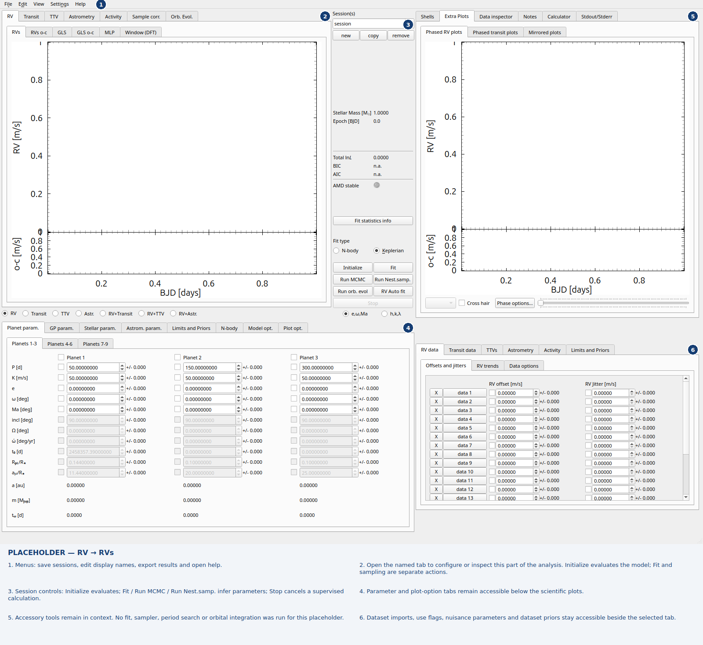
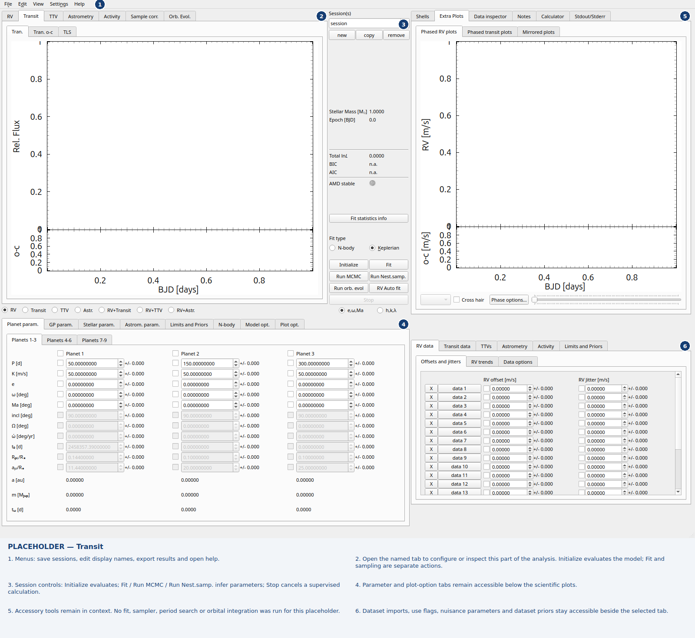
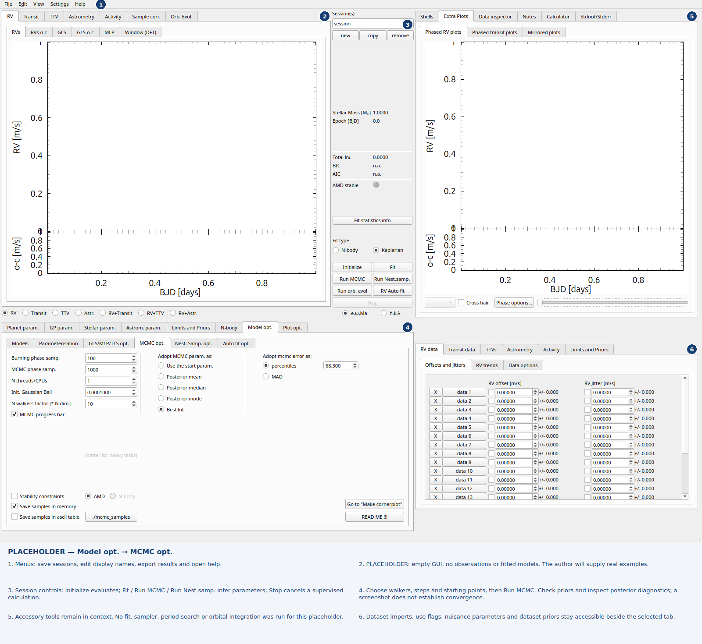
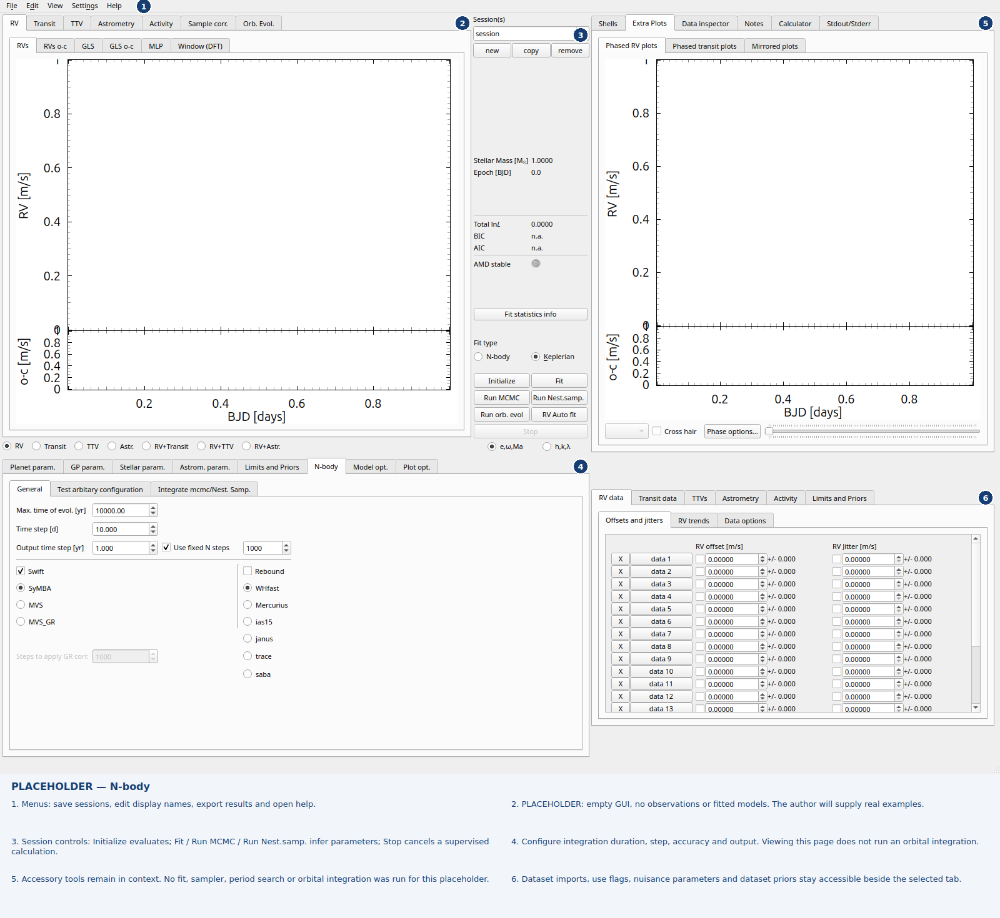

Annotated GUI walkthrough
=========================

These are annotated **empty GUI placeholders**, awaiting real examples supplied by the author. Each full-window view keeps the layout consistent as different tabs are opened. No observations, invented data or fitted models are shown. Numbers identify the same six regions in every image. See :doc:`tab-gallery` for every accessible tab, grouped by workflow.

RV → RVs
--------

   Empty GUI placeholder with the relevant tabs open.

1. Menus: save sessions, edit display names, export results and open help.
2. Open the named tab to configure or inspect this part of the analysis. Initialize evaluates the model; Fit and sampling are separate actions.
3. Session controls: Initialize evaluates; Fit / Run MCMC / Run Nest.samp. infer parameters; Stop cancels a supervised calculation.
4. Parameter and plot-option tabs remain accessible below the scientific plots.
5. Accessory tools remain in context. No fit, sampler, period search or orbital integration was run for this placeholder.
6. Dataset imports, use flags, nuisance parameters and dataset priors stay accessible beside the selected tab.

Transit
-------

   Empty GUI placeholder with the relevant tabs open.

1. Menus: save sessions, edit display names, export results and open help.
2. Open the named tab to configure or inspect this part of the analysis. Initialize evaluates the model; Fit and sampling are separate actions.
3. Session controls: Initialize evaluates; Fit / Run MCMC / Run Nest.samp. infer parameters; Stop cancels a supervised calculation.
4. Parameter and plot-option tabs remain accessible below the scientific plots.
5. Accessory tools remain in context. No fit, sampler, period search or orbital integration was run for this placeholder.
6. Dataset imports, use flags, nuisance parameters and dataset priors stay accessible beside the selected tab.

Model opt. → MCMC opt.
----------------------

   Empty GUI placeholder with the relevant tabs open.

1. Menus: save sessions, edit display names, export results and open help.
2. PLACEHOLDER: empty GUI, no observations or fitted models. The author will supply real examples.
3. Session controls: Initialize evaluates; Fit / Run MCMC / Run Nest.samp. infer parameters; Stop cancels a supervised calculation.
4. Choose walkers, steps and starting points, then Run MCMC. Check priors and inspect posterior diagnostics; a screenshot does not establish convergence.
5. Accessory tools remain in context. No fit, sampler, period search or orbital integration was run for this placeholder.
6. Dataset imports, use flags, nuisance parameters and dataset priors stay accessible beside the selected tab.

N-body
------

   Empty GUI placeholder with the relevant tabs open.

1. Menus: save sessions, edit display names, export results and open help.
2. PLACEHOLDER: empty GUI, no observations or fitted models. The author will supply real examples.
3. Session controls: Initialize evaluates; Fit / Run MCMC / Run Nest.samp. infer parameters; Stop cancels a supervised calculation.
4. Configure integration duration, step, accuracy and output. Viewing this page does not run an orbital integration.
5. Accessory tools remain in context. No fit, sampler, period search or orbital integration was run for this placeholder.
6. Dataset imports, use flags, nuisance parameters and dataset priors stay accessible beside the selected tab.

Activity and QSO workflows
--------------------------

See :doc:`tab-activity` for the new activity time-series, residual GLS, correlation options and file-name editing placeholders. See :doc:`activity` for the joint GP and magnetic-cycle controls, and :doc:`qso-mode` for the separate QSO presentation.
