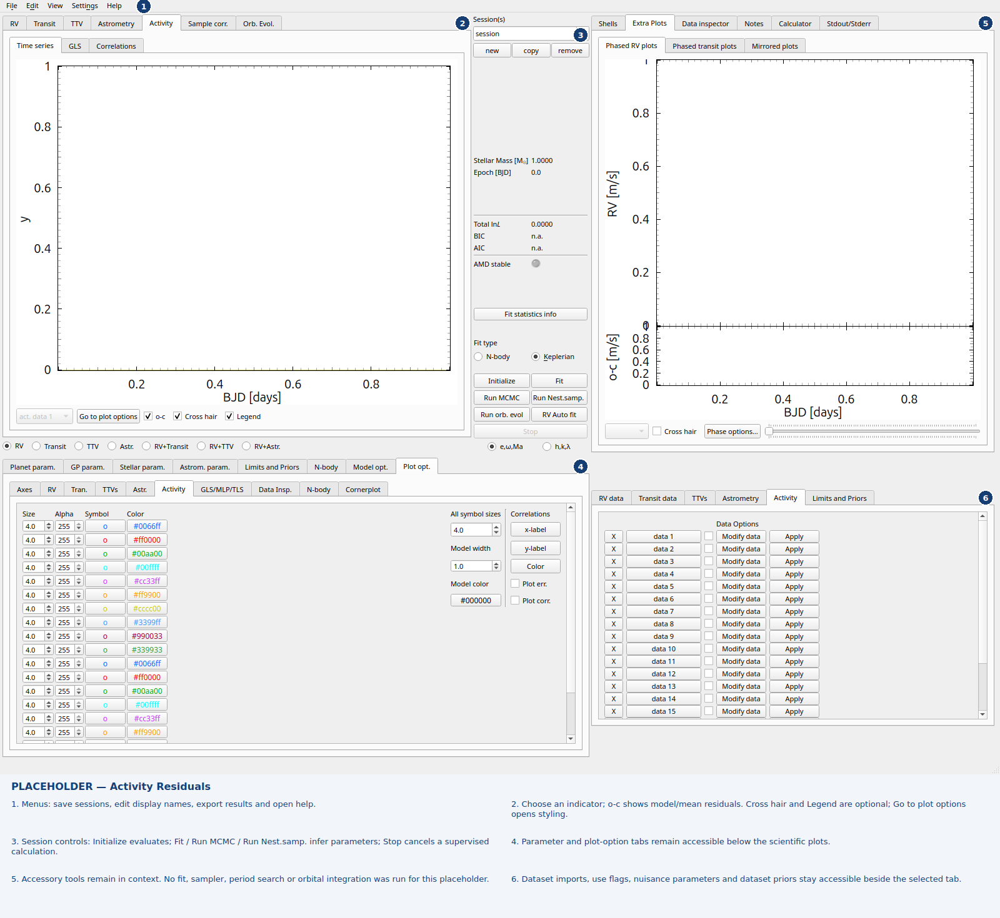
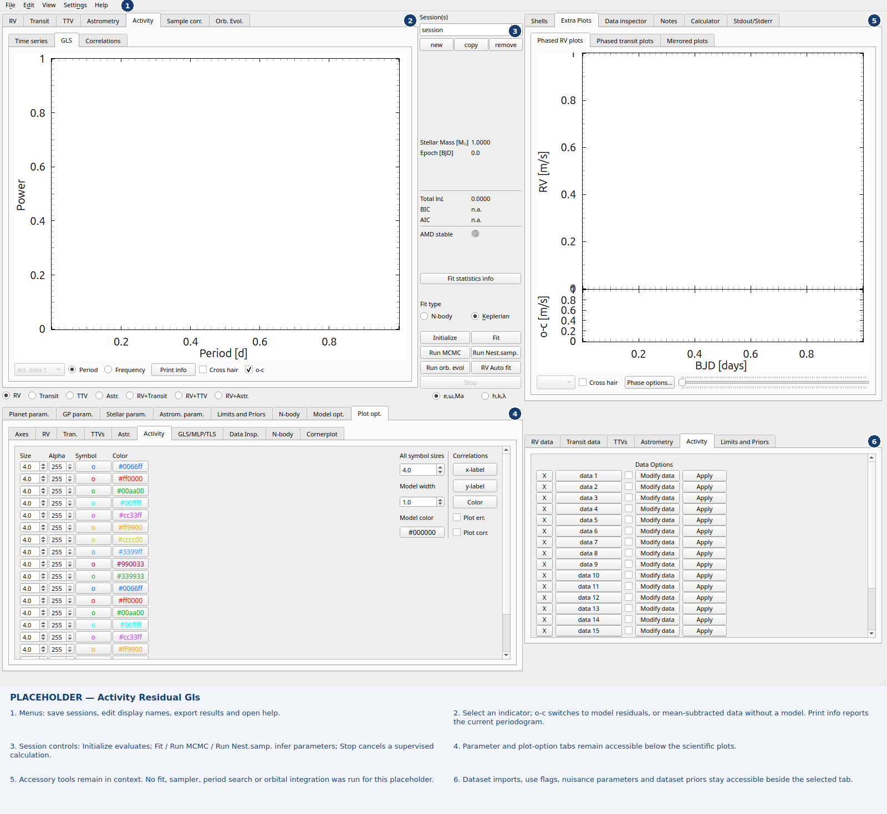
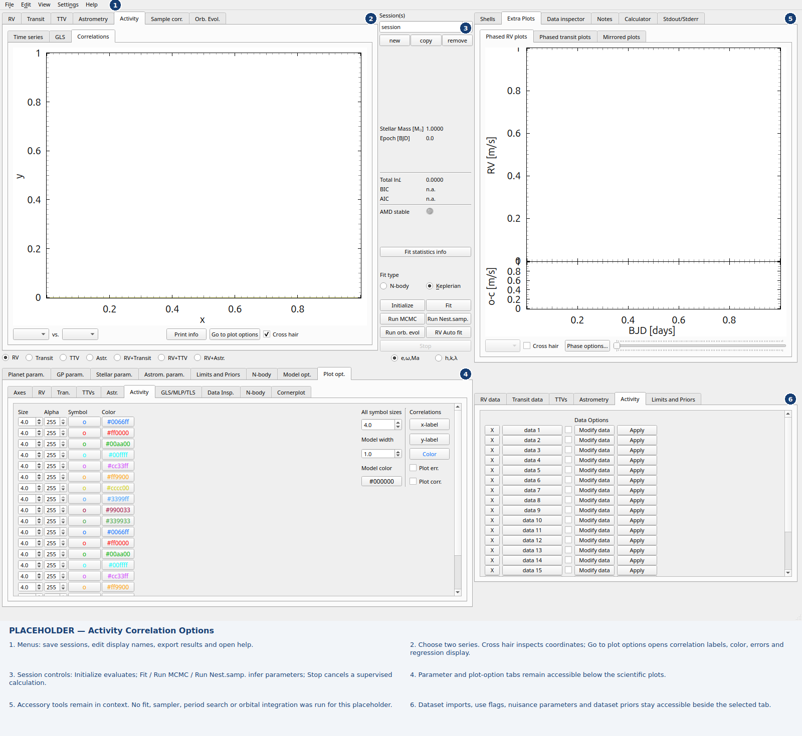
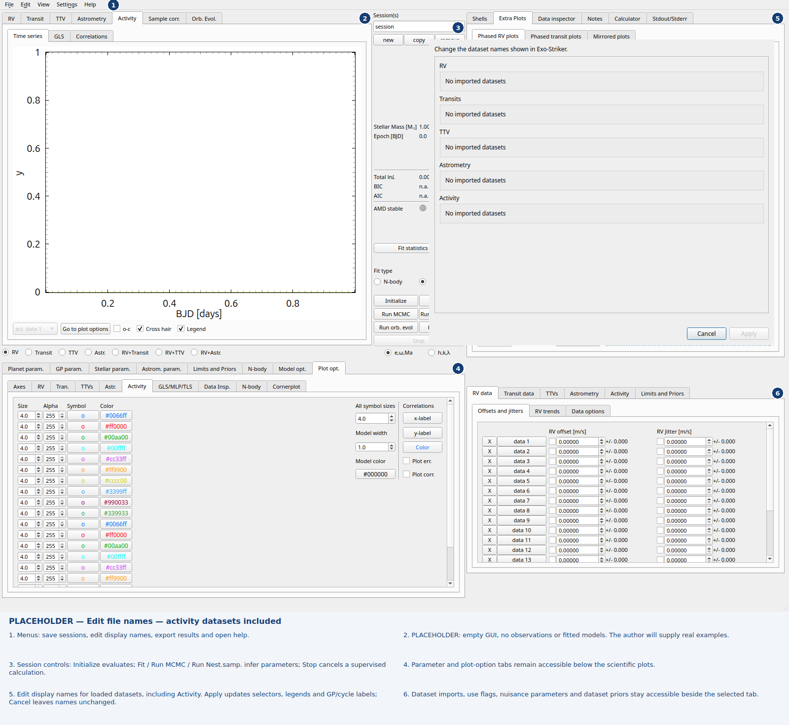

New activity workflows and file names
=====================================

See :doc:`tab-gallery` for the capture conventions and six numbered regions.

.. contents:: Open tabs
   :local:
   :depth: 1

.. _gui-tab-activity-residuals:

Activity Residuals
------------------

   Empty GUI placeholder, awaiting an author-provided real example. Choose an indicator; o-c shows model/mean residuals. Cross hair and Legend are optional; Go to plot options opens styling.

.. _gui-tab-activity-residual-gls:

Activity Residual Gls
---------------------

   Empty GUI placeholder, awaiting an author-provided real example. Select an indicator; o-c switches to model residuals, or mean-subtracted data without a model. Print info reports the current periodogram.

.. _gui-tab-activity-correlation-options:

Activity Correlation Options
----------------------------

   Empty GUI placeholder, awaiting an author-provided real example. Choose two series. Cross hair inspects coordinates; Go to plot options opens correlation labels, color, errors and regression display.

.. _gui-tab-dataset-names:

Edit file names — activity datasets included
--------------------------------------------

   Empty GUI placeholder, awaiting an author-provided real example. Edit display names for loaded datasets, including Activity. Apply updates selectors, legends and GP/cycle labels; Cancel leaves names unchanged.

