GP and magnetic-cycle tabs
==========================

See :doc:`tab-gallery` for the capture conventions and six numbered regions.

.. contents:: Open tabs
   :local:
   :depth: 1

.. _gui-tab-tab_GP_param:

GP param.
---------

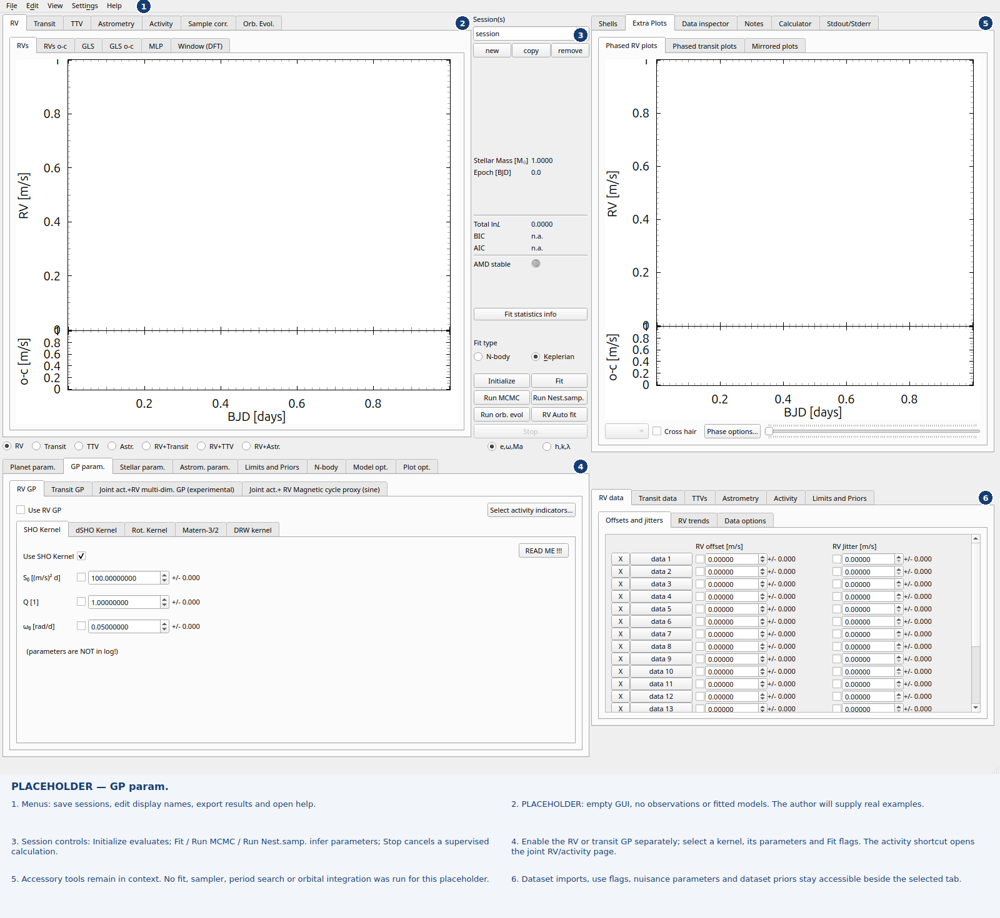

   Empty GUI placeholder, awaiting an author-provided real example. Enable the RV or transit GP separately; select a kernel, its parameters and Fit flags. The activity shortcut opens the joint RV/activity page.

.. _gui-tab-tab_60:

GP param. → RV GP
-----------------

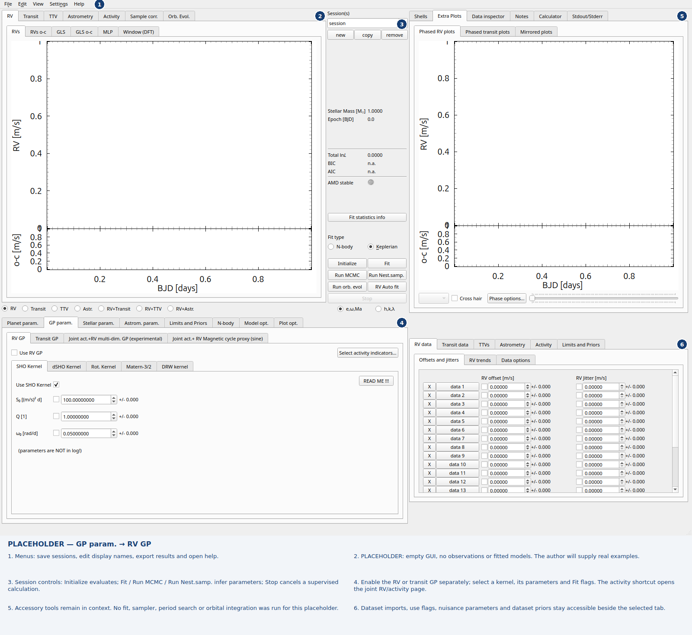

   Empty GUI placeholder, awaiting an author-provided real example. Enable the RV or transit GP separately; select a kernel, its parameters and Fit flags. The activity shortcut opens the joint RV/activity page.

.. _gui-tab-tab_79:

GP param. → Transit GP
----------------------

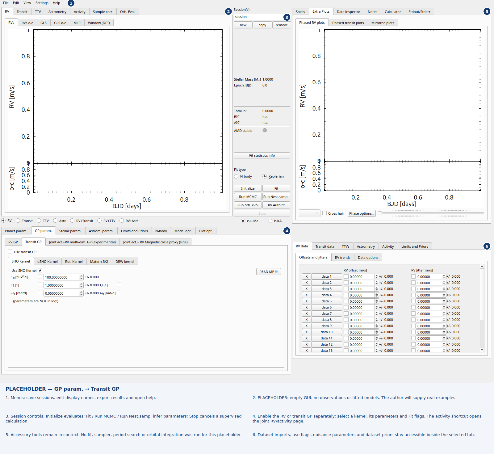

   Empty GUI placeholder, awaiting an author-provided real example. Enable the RV or transit GP separately; select a kernel, its parameters and Fit flags. The activity shortcut opens the joint RV/activity page.

.. _gui-tab-tab_activity_joint_gp:

GP param. → Joint act.+RV multi-dim. GP (experimental)
------------------------------------------------------

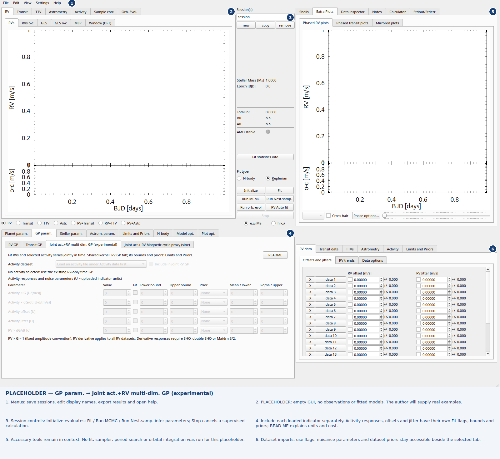

   Empty GUI placeholder, awaiting an author-provided real example. Include each loaded indicator separately. Activity responses, offsets and jitter have their own Fit flags, bounds and priors; READ ME explains units and cost.

.. _gui-tab-tab_magnetic_cycle:

GP param. → Joint act.+ RV Magnetic cycle proxy (sine)
------------------------------------------------------

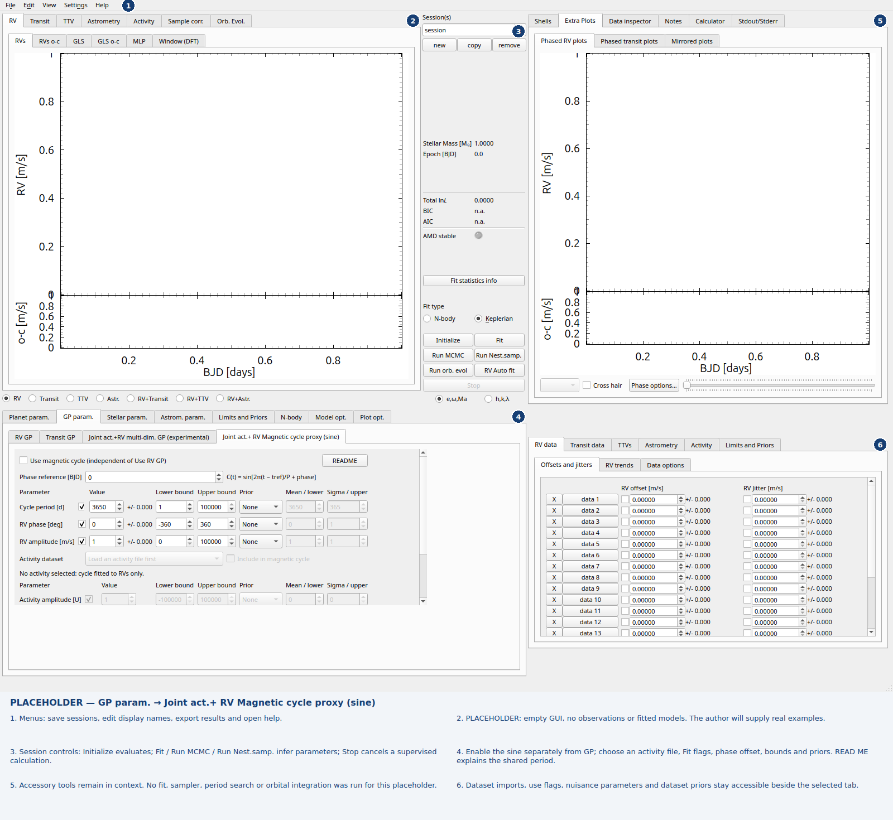

   Empty GUI placeholder, awaiting an author-provided real example. Enable the sine separately from GP; choose an activity file, Fit flags, phase offset, bounds and priors. READ ME explains the shared period.

.. _gui-tab-tab_50:

GP param. → RV GP → SHO Kernel
------------------------------

   Empty GUI placeholder, awaiting an author-provided real example. Review the kernel parameters and units; Fit flags choose free coordinates. GP priors are configured under Limits and Priors.

.. _gui-tab-tab_139:

GP param. → RV GP → dSHO Kernel
-------------------------------

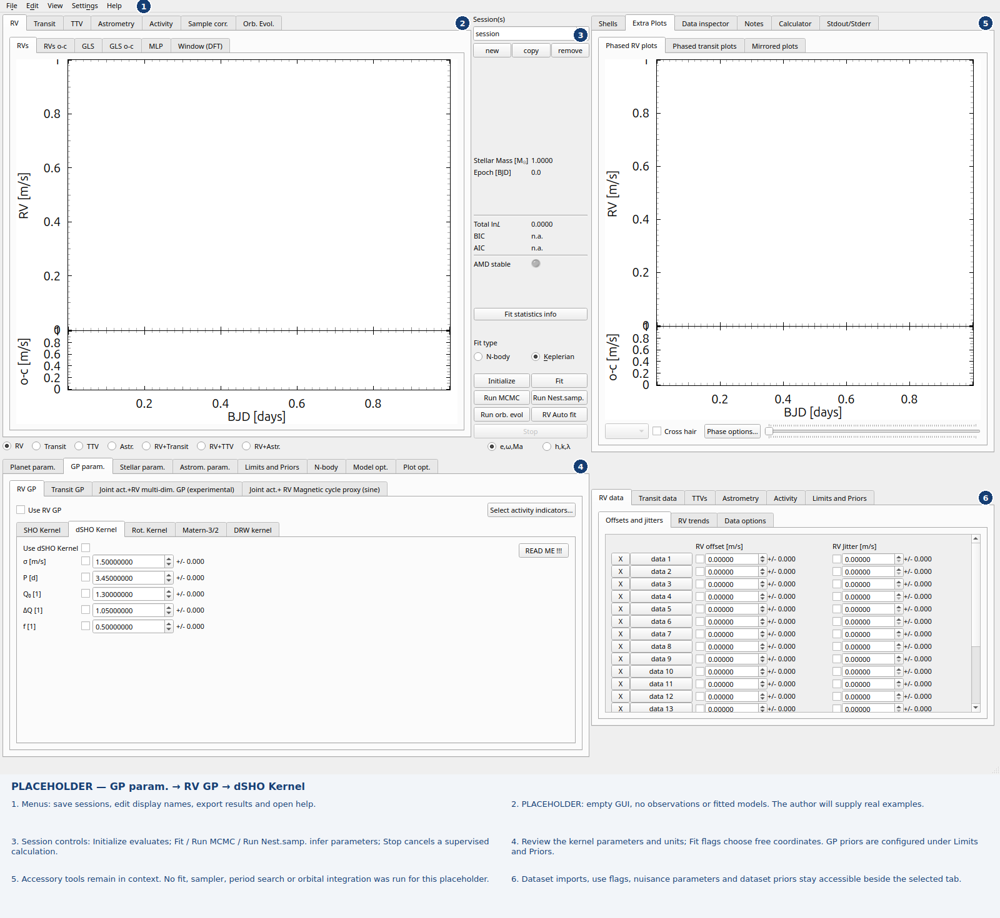

   Empty GUI placeholder, awaiting an author-provided real example. Review the kernel parameters and units; Fit flags choose free coordinates. GP priors are configured under Limits and Priors.

.. _gui-tab-tab_48:

GP param. → RV GP → Rot. Kernel
-------------------------------

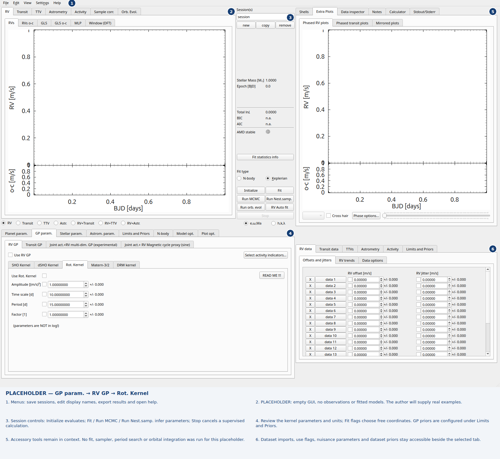

   Empty GUI placeholder, awaiting an author-provided real example. Review the kernel parameters and units; Fit flags choose free coordinates. GP priors are configured under Limits and Priors.

.. _gui-tab-tab_37:

GP param. → RV GP → Matern-3/2
------------------------------

   Empty GUI placeholder, awaiting an author-provided real example. Enable the RV or transit GP separately; select a kernel, its parameters and Fit flags. The activity shortcut opens the joint RV/activity page.

.. _gui-tab-tab_175:

GP param. → RV GP → DRW kernel
------------------------------

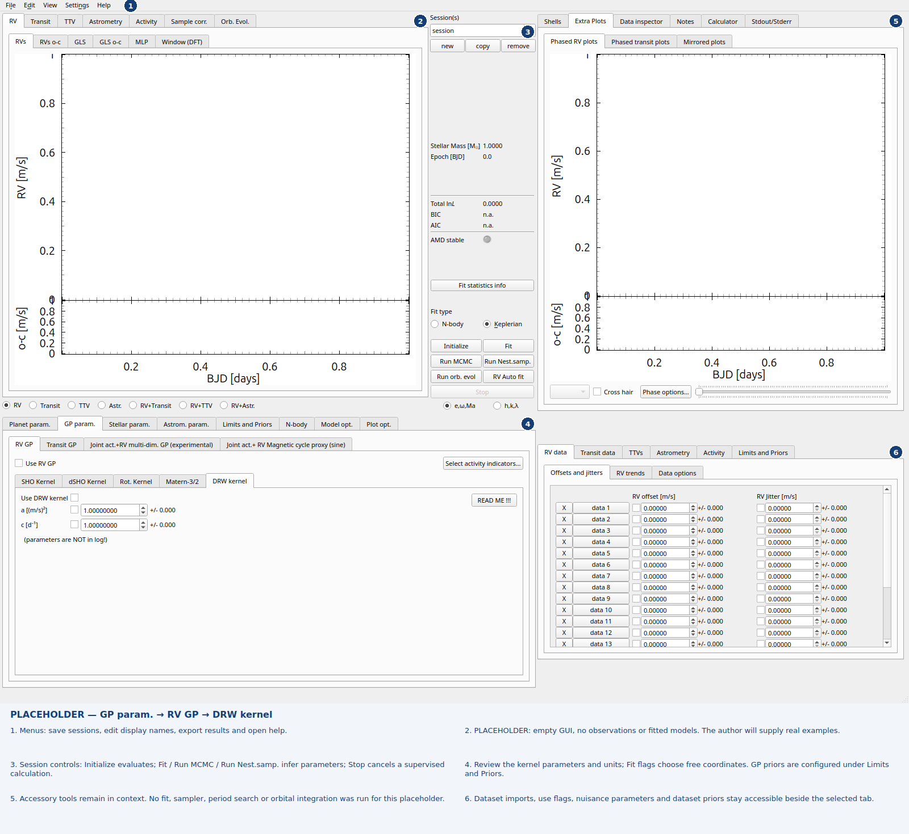

   Empty GUI placeholder, awaiting an author-provided real example. Review the kernel parameters and units; Fit flags choose free coordinates. GP priors are configured under Limits and Priors.

.. _gui-tab-tab_105:

GP param. → Transit GP → SHO Kernel
-----------------------------------

   Empty GUI placeholder, awaiting an author-provided real example. Review the kernel parameters and units; Fit flags choose free coordinates. GP priors are configured under Limits and Priors.

.. _gui-tab-tab_141:

GP param. → Transit GP → dSHO Kernel
------------------------------------

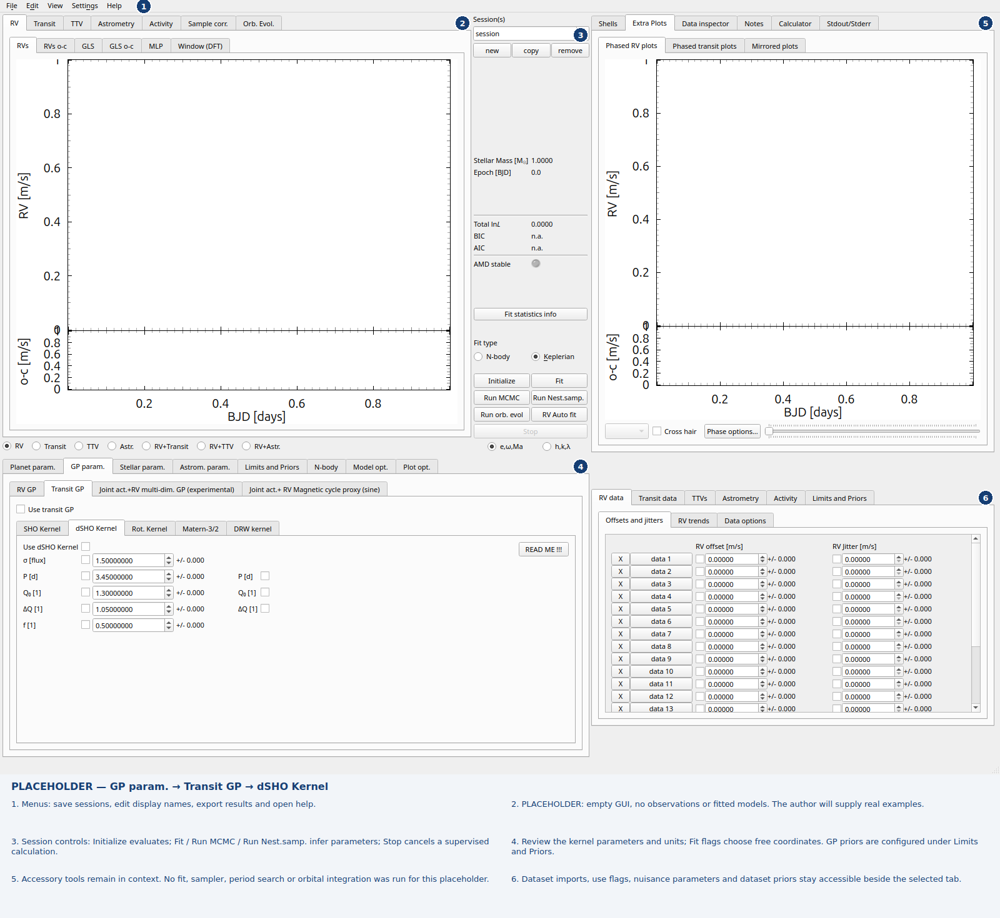

   Empty GUI placeholder, awaiting an author-provided real example. Review the kernel parameters and units; Fit flags choose free coordinates. GP priors are configured under Limits and Priors.

.. _gui-tab-tab_106:

GP param. → Transit GP → Rot. Kernel
------------------------------------

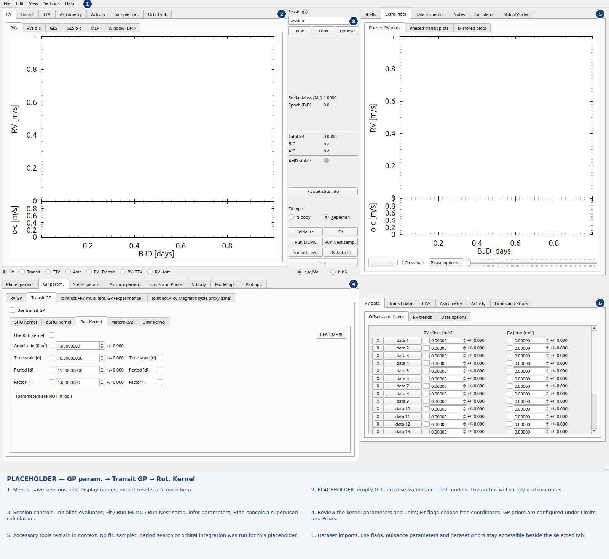

   Empty GUI placeholder, awaiting an author-provided real example. Review the kernel parameters and units; Fit flags choose free coordinates. GP priors are configured under Limits and Priors.

.. _gui-tab-tab_38:

GP param. → Transit GP → Matern-3/2
-----------------------------------

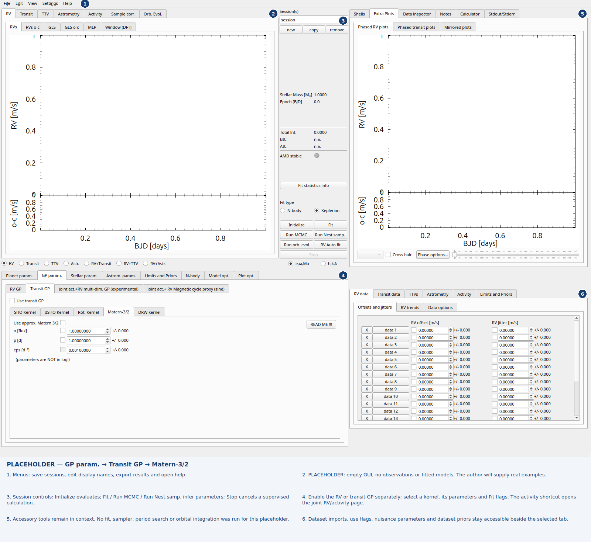

   Empty GUI placeholder, awaiting an author-provided real example. Enable the RV or transit GP separately; select a kernel, its parameters and Fit flags. The activity shortcut opens the joint RV/activity page.

.. _gui-tab-tab_176:

GP param. → Transit GP → DRW kernel
-----------------------------------

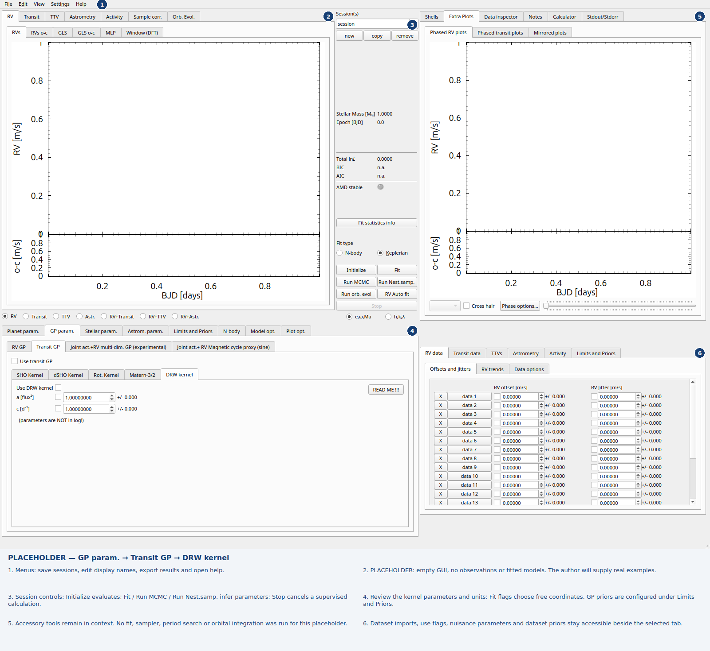

   Empty GUI placeholder, awaiting an author-provided real example. Review the kernel parameters and units; Fit flags choose free coordinates. GP priors are configured under Limits and Priors.

