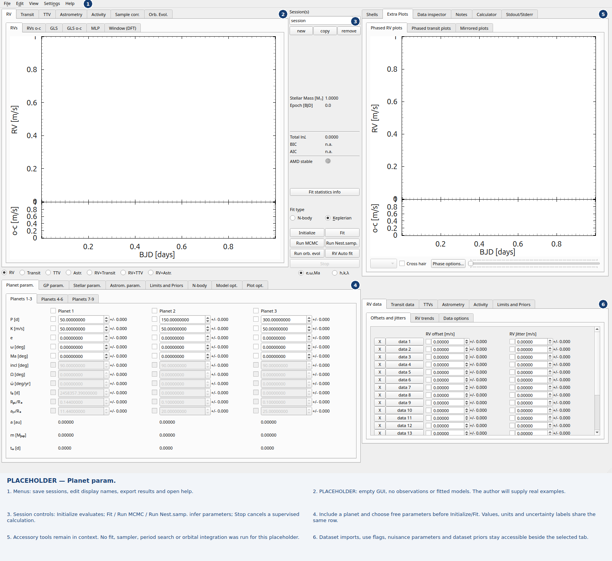
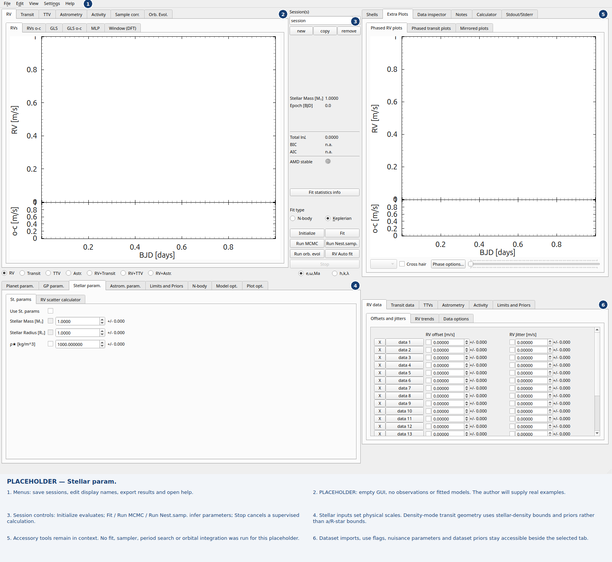
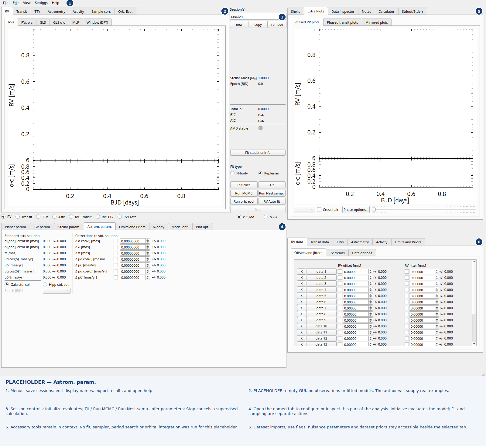
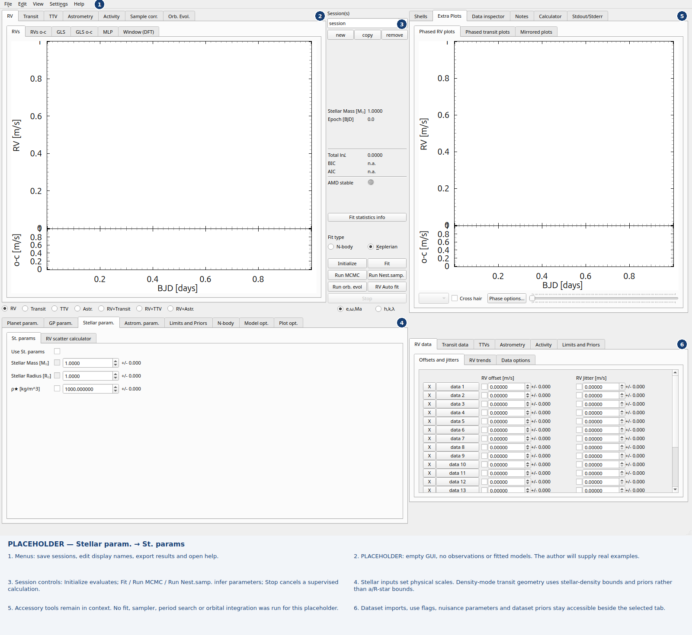
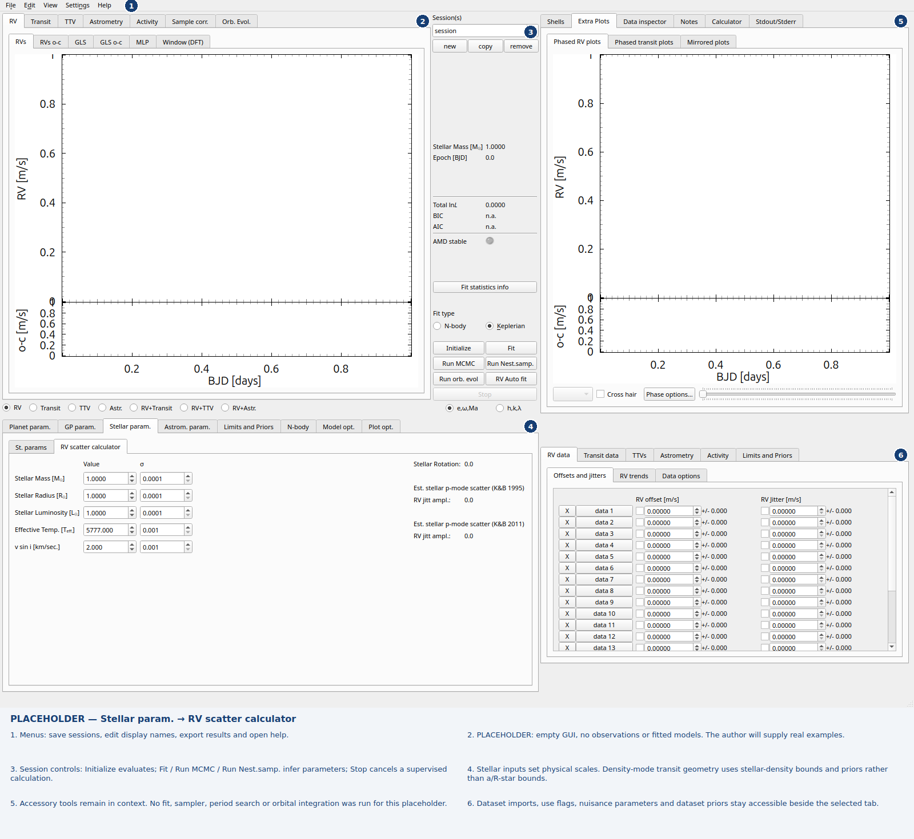

Physical parameter tabs
=======================

See :doc:`tab-gallery` for the capture conventions and six numbered regions.

.. contents:: Open tabs
   :local:
   :depth: 1

.. _gui-tab-tab_RV_pl_param:

Planet param.
-------------

   Empty GUI placeholder, awaiting an author-provided real example. Include a planet and choose free parameters before Initialize/Fit. Values, units and uncertainty labels share the same row.

.. _gui-tab-Stellar_param_tab:

Stellar param.
--------------

   Empty GUI placeholder, awaiting an author-provided real example. Stellar inputs set physical scales. Density-mode transit geometry uses stellar-density bounds and priors rather than a/R-star bounds.

.. _gui-tab-tab_203:

Astrom. param.
--------------

   Empty GUI placeholder, awaiting an author-provided real example. Open the named tab to configure or inspect this part of the analysis. Initialize evaluates the model; Fit and sampling are separate actions.

.. _gui-tab-tab_2:

Planet param. → Planets 1-3
---------------------------

   Empty GUI placeholder, awaiting an author-provided real example. Include a planet and choose free parameters before Initialize/Fit. Values, units and uncertainty labels share the same row.

.. _gui-tab-tab_7:

Planet param. → Planets 4-6
---------------------------

   Empty GUI placeholder, awaiting an author-provided real example. Include a planet and choose free parameters before Initialize/Fit. Values, units and uncertainty labels share the same row.

.. _gui-tab-tab_8:

Planet param. → Planets 7-9
---------------------------

   Empty GUI placeholder, awaiting an author-provided real example. Include a planet and choose free parameters before Initialize/Fit. Values, units and uncertainty labels share the same row.

.. _gui-tab-tab_193:

Stellar param. → St. params
---------------------------

   Empty GUI placeholder, awaiting an author-provided real example. Stellar inputs set physical scales. Density-mode transit geometry uses stellar-density bounds and priors rather than a/R-star bounds.

.. _gui-tab-tab_205:

Stellar param. → RV scatter calculator
--------------------------------------

   Empty GUI placeholder, awaiting an author-provided real example. Stellar inputs set physical scales. Density-mode transit geometry uses stellar-density bounds and priors rather than a/R-star bounds.

