Scientific plot tabs
====================

See :doc:`tab-gallery` for the capture conventions and six numbered regions.

.. contents:: Open tabs
   :local:
   :depth: 1

.. _gui-tab-tab_timeseries_RV:

RV
--

   Empty GUI placeholder, awaiting an author-provided real example. Open the named tab to configure or inspect this part of the analysis. Initialize evaluates the model; Fit and sampling are separate actions.

.. _gui-tab-tab_timeseries_tra:

Transit
-------

   Empty GUI placeholder, awaiting an author-provided real example. Open the named tab to configure or inspect this part of the analysis. Initialize evaluates the model; Fit and sampling are separate actions.

.. _gui-tab-tab_timeseries_ttv:

TTV
---

   Empty GUI placeholder, awaiting an author-provided real example. Open the named tab to configure or inspect this part of the analysis. Initialize evaluates the model; Fit and sampling are separate actions.

.. _gui-tab-tab_timeseries_ast:

Astrometry
----------

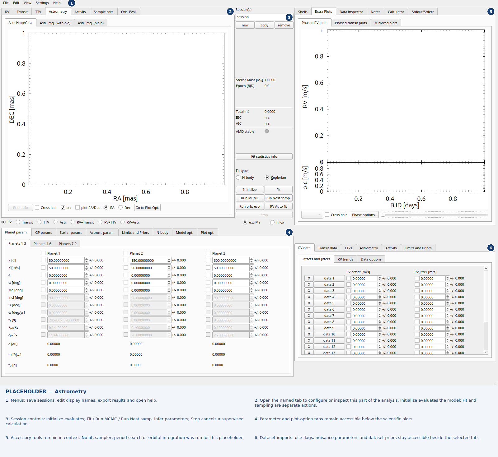

   Empty GUI placeholder, awaiting an author-provided real example. Open the named tab to configure or inspect this part of the analysis. Initialize evaluates the model; Fit and sampling are separate actions.

.. _gui-tab-tab_timeseries_act:

Activity
--------

   Empty GUI placeholder, awaiting an author-provided real example. Open the named tab to configure or inspect this part of the analysis. Initialize evaluates the model; Fit and sampling are separate actions.

.. _gui-tab-Parameter_correlations:

Sample corr.
------------

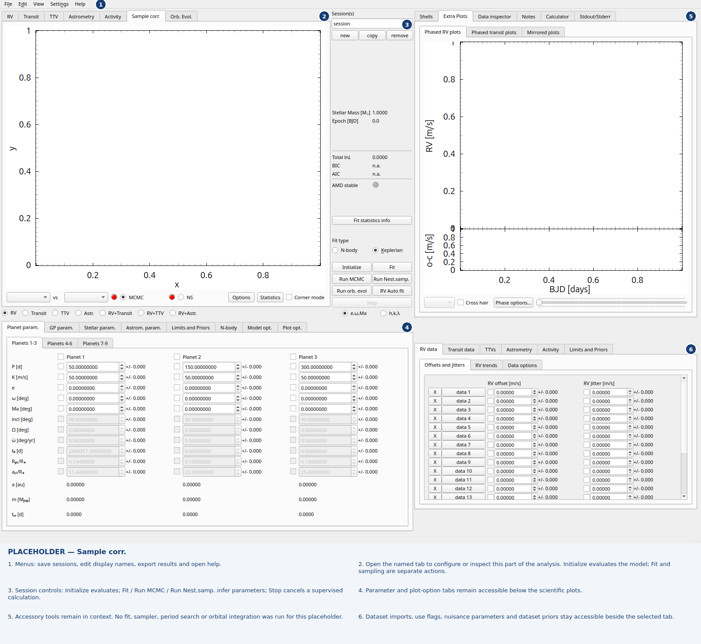

   Empty GUI placeholder, awaiting an author-provided real example. Open the named tab to configure or inspect this part of the analysis. Initialize evaluates the model; Fit and sampling are separate actions.

.. _gui-tab-tab_Orbital_evol:

Orb. Evol.
----------

   Empty GUI placeholder, awaiting an author-provided real example. Open the named tab to configure or inspect this part of the analysis. Initialize evaluates the model; Fit and sampling are separate actions.

.. _gui-tab-RV_time_series_tab:

RV → RVs
--------

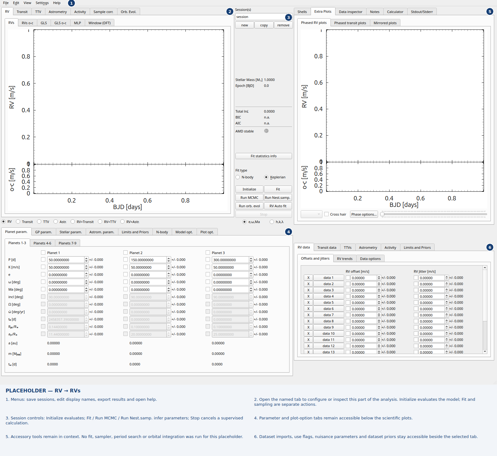

   Empty GUI placeholder, awaiting an author-provided real example. Open the named tab to configure or inspect this part of the analysis. Initialize evaluates the model; Fit and sampling are separate actions.

.. _gui-tab-tab_171:

RV → RVs o-c
------------

   Empty GUI placeholder, awaiting an author-provided real example. Open the named tab to configure or inspect this part of the analysis. Initialize evaluates the model; Fit and sampling are separate actions.

.. _gui-tab-RV_timeseries_periodogram:

RV → GLS
--------

   Empty GUI placeholder, awaiting an author-provided real example. Set period/frequency search ranges and resolution. Interpret peaks with the sampling window and residual model in mind.

.. _gui-tab-tab_172:

RV → GLS o-c
------------

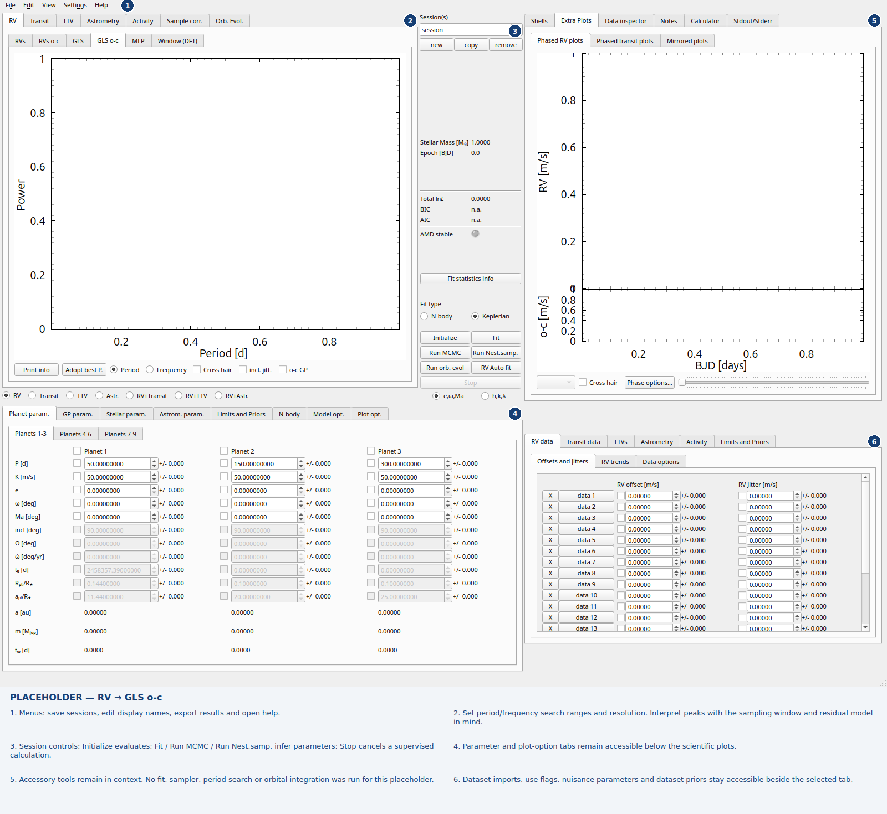

   Empty GUI placeholder, awaiting an author-provided real example. Set period/frequency search ranges and resolution. Interpret peaks with the sampling window and residual model in mind.

.. _gui-tab-tab_157:

RV → MLP
--------

   Empty GUI placeholder, awaiting an author-provided real example. Open the named tab to configure or inspect this part of the analysis. Initialize evaluates the model; Fit and sampling are separate actions.

.. _gui-tab-Window_func_periodograms:

RV → Window (DFT)
-----------------

   Empty GUI placeholder, awaiting an author-provided real example. Open the named tab to configure or inspect this part of the analysis. Initialize evaluates the model; Fit and sampling are separate actions.

.. _gui-tab-Phot_timeseries_plot:

Transit → Tran.
---------------

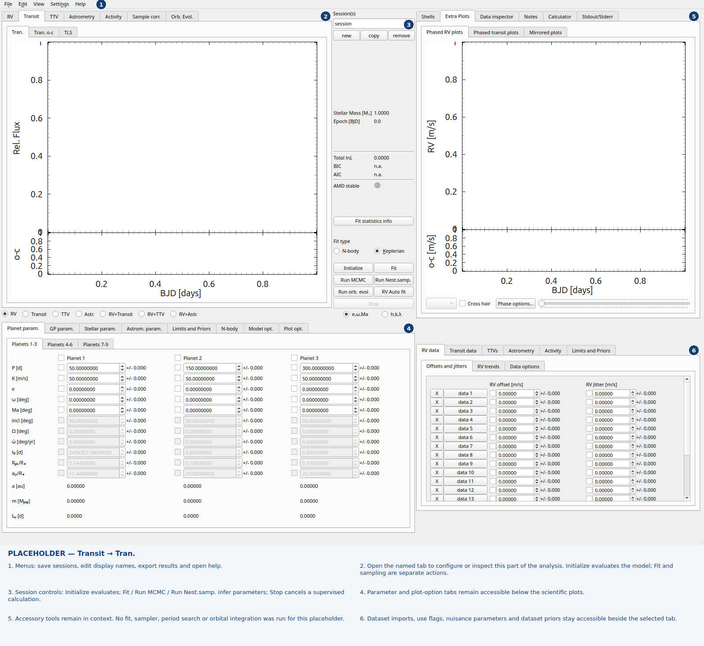

   Empty GUI placeholder, awaiting an author-provided real example. Open the named tab to configure or inspect this part of the analysis. Initialize evaluates the model; Fit and sampling are separate actions.

.. _gui-tab-tab_173:

Transit → Tran. o-c
-------------------

   Empty GUI placeholder, awaiting an author-provided real example. Open the named tab to configure or inspect this part of the analysis. Initialize evaluates the model; Fit and sampling are separate actions.

.. _gui-tab-tab_174:

Transit → TLS
-------------

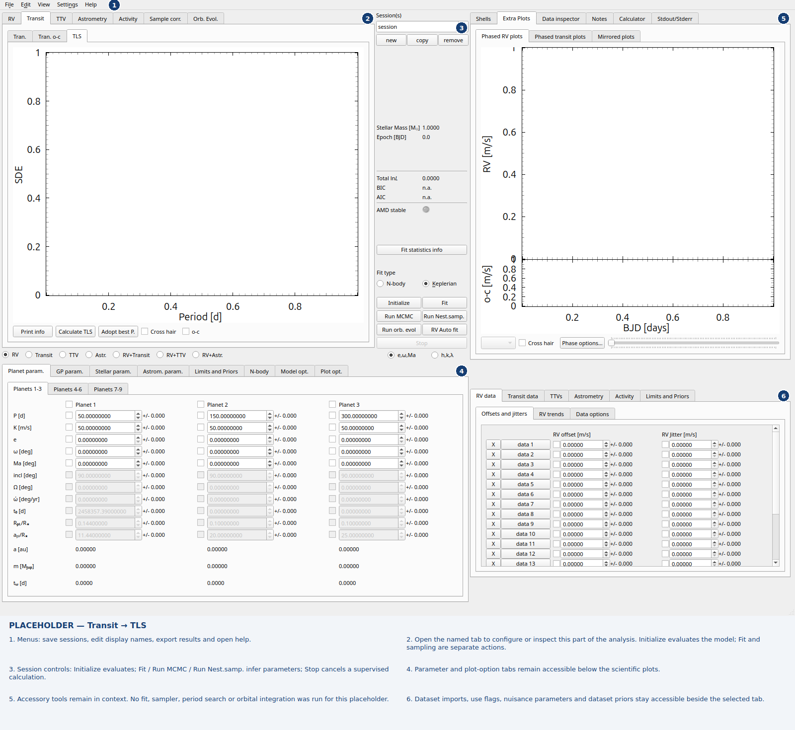

   Empty GUI placeholder, awaiting an author-provided real example. Open the named tab to configure or inspect this part of the analysis. Initialize evaluates the model; Fit and sampling are separate actions.

.. _gui-tab-tab_170:

TTV → TTVs
----------

   Empty GUI placeholder, awaiting an author-provided real example. Open the named tab to configure or inspect this part of the analysis. Initialize evaluates the model; Fit and sampling are separate actions.

.. _gui-tab-Phot_o_c_timeseries_plot_2:

TTV → TDVs
----------

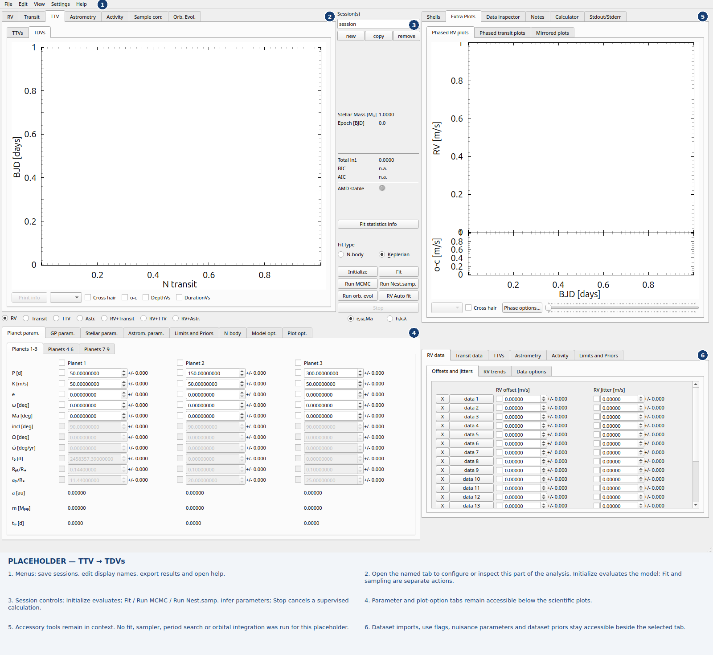

   Empty GUI placeholder, awaiting an author-provided real example. Open the named tab to configure or inspect this part of the analysis. Initialize evaluates the model; Fit and sampling are separate actions.

.. _gui-tab-tab_197:

Astrometry → Astr. Hipp/Gaia
----------------------------

   Empty GUI placeholder, awaiting an author-provided real example. Open the named tab to configure or inspect this part of the analysis. Initialize evaluates the model; Fit and sampling are separate actions.

.. _gui-tab-tab_190:

Astrometry → Astr. img. (with o-c)
----------------------------------

   Empty GUI placeholder, awaiting an author-provided real example. Open the named tab to configure or inspect this part of the analysis. Initialize evaluates the model; Fit and sampling are separate actions.

.. _gui-tab-Phot_o_c_timeseries_plot_3:

Astrometry → Astr. img. (plain)
-------------------------------

   Empty GUI placeholder, awaiting an author-provided real example. Open the named tab to configure or inspect this part of the analysis. Initialize evaluates the model; Fit and sampling are separate actions.

.. _gui-tab-Activity_index_timeseries_plot:

Activity → Time series
----------------------

   Empty GUI placeholder, awaiting an author-provided real example. Choose an indicator; o-c shows model/mean residuals. Cross hair and Legend are optional; Go to plot options opens styling.

.. _gui-tab-activity_index_periodograms:

Activity → GLS
--------------

   Empty GUI placeholder, awaiting an author-provided real example. Select an indicator; o-c switches to model residuals, or mean-subtracted data without a model. Print info reports the current periodogram.

.. _gui-tab-Correlations_timeseries_plot:

Activity → Correlations
-----------------------

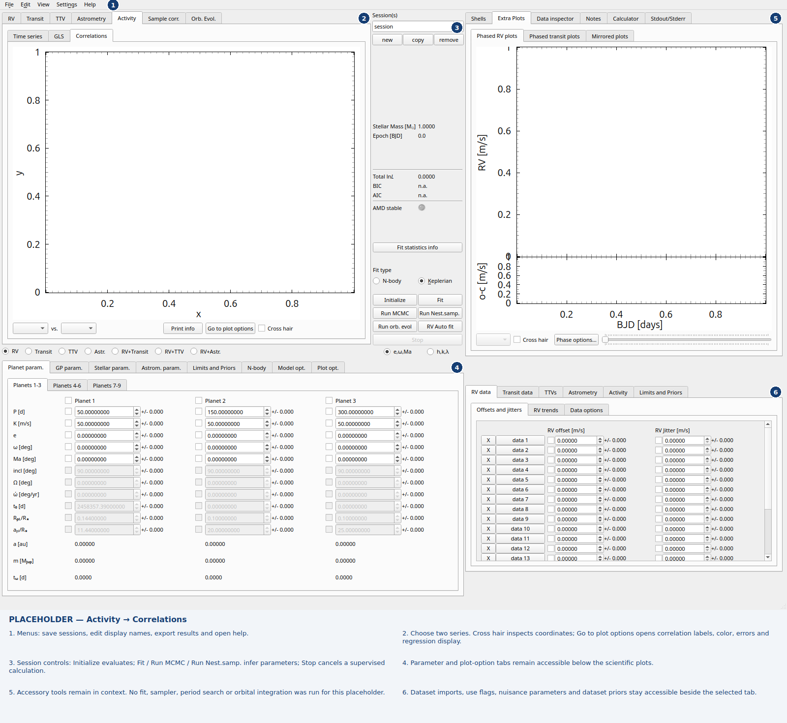

   Empty GUI placeholder, awaiting an author-provided real example. Choose two series. Cross hair inspects coordinates; Go to plot options opens correlation labels, color, errors and regression display.

.. _gui-tab-tab_13:

Orb. Evol. → Orb. elem.
-----------------------

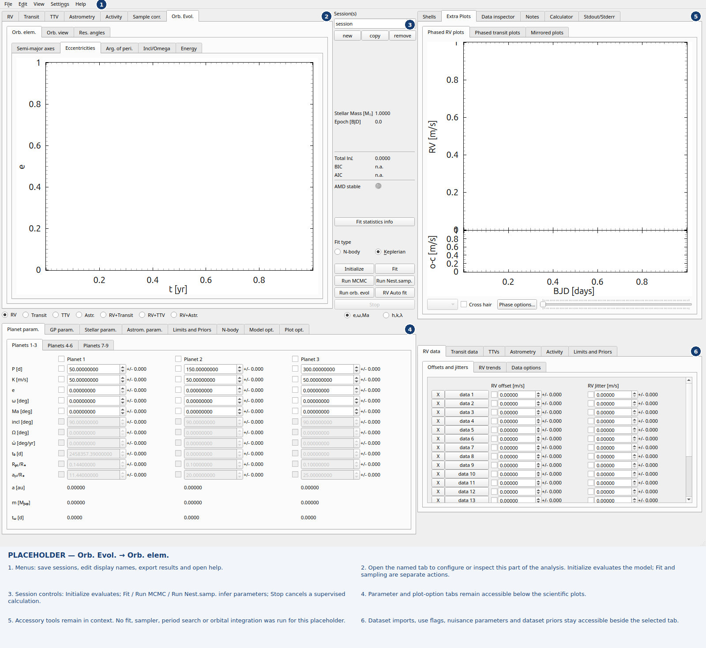

   Empty GUI placeholder, awaiting an author-provided real example. Open the named tab to configure or inspect this part of the analysis. Initialize evaluates the model; Fit and sampling are separate actions.

.. _gui-tab-tab_14:

Orb. Evol. → Orb. view
----------------------

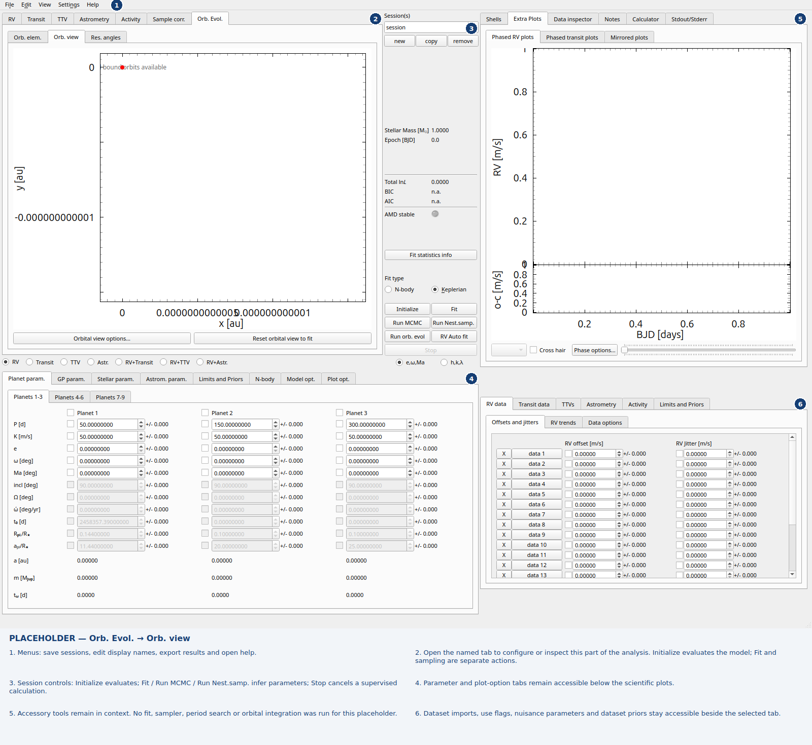

   Empty GUI placeholder, awaiting an author-provided real example. Open the named tab to configure or inspect this part of the analysis. Initialize evaluates the model; Fit and sampling are separate actions.

.. _gui-tab-tab_23:

Orb. Evol. → Res. angles
------------------------

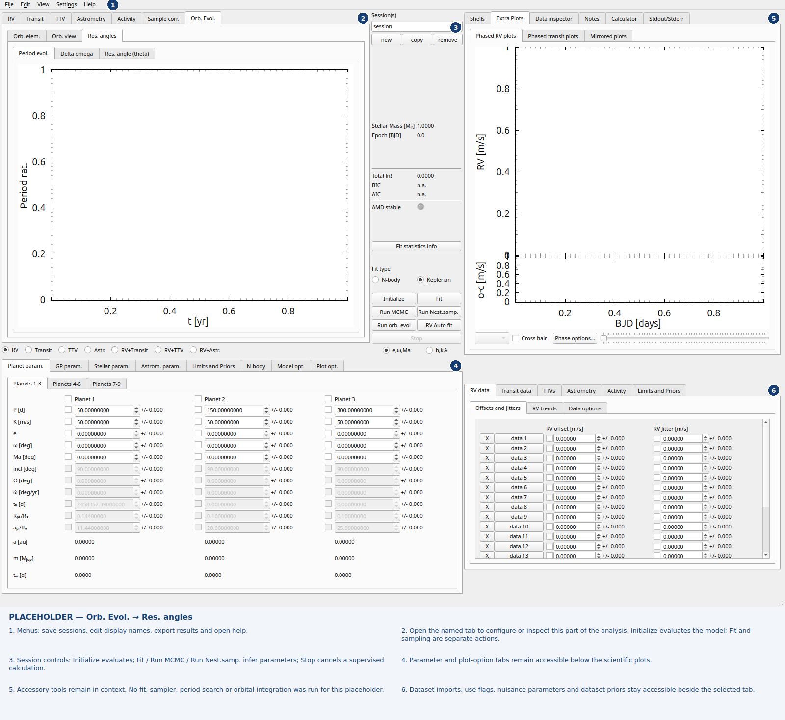

   Empty GUI placeholder, awaiting an author-provided real example. Open the named tab to configure or inspect this part of the analysis. Initialize evaluates the model; Fit and sampling are separate actions.

.. _gui-tab-tab_27:

Orb. Evol. → Orb. elem. → Semi-major axes
-----------------------------------------

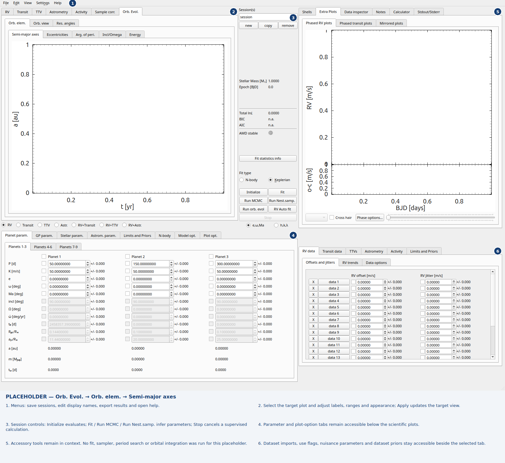

   Empty GUI placeholder, awaiting an author-provided real example. Select the target plot and adjust labels, ranges and appearance; Apply updates the target view.

.. _gui-tab-tab_28:

Orb. Evol. → Orb. elem. → Eccentricities
----------------------------------------

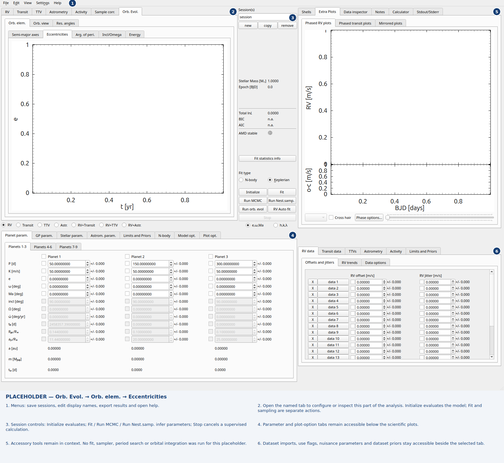

   Empty GUI placeholder, awaiting an author-provided real example. Open the named tab to configure or inspect this part of the analysis. Initialize evaluates the model; Fit and sampling are separate actions.

.. _gui-tab-tab_118:

Orb. Evol. → Orb. elem. → Arg. of peri.
---------------------------------------

   Empty GUI placeholder, awaiting an author-provided real example. Open the named tab to configure or inspect this part of the analysis. Initialize evaluates the model; Fit and sampling are separate actions.

.. _gui-tab-tab_92:

Orb. Evol. → Orb. elem. → Incl/Omega
------------------------------------

   Empty GUI placeholder, awaiting an author-provided real example. Open the named tab to configure or inspect this part of the analysis. Initialize evaluates the model; Fit and sampling are separate actions.

.. _gui-tab-tab_114:

Orb. Evol. → Orb. elem. → Energy
--------------------------------

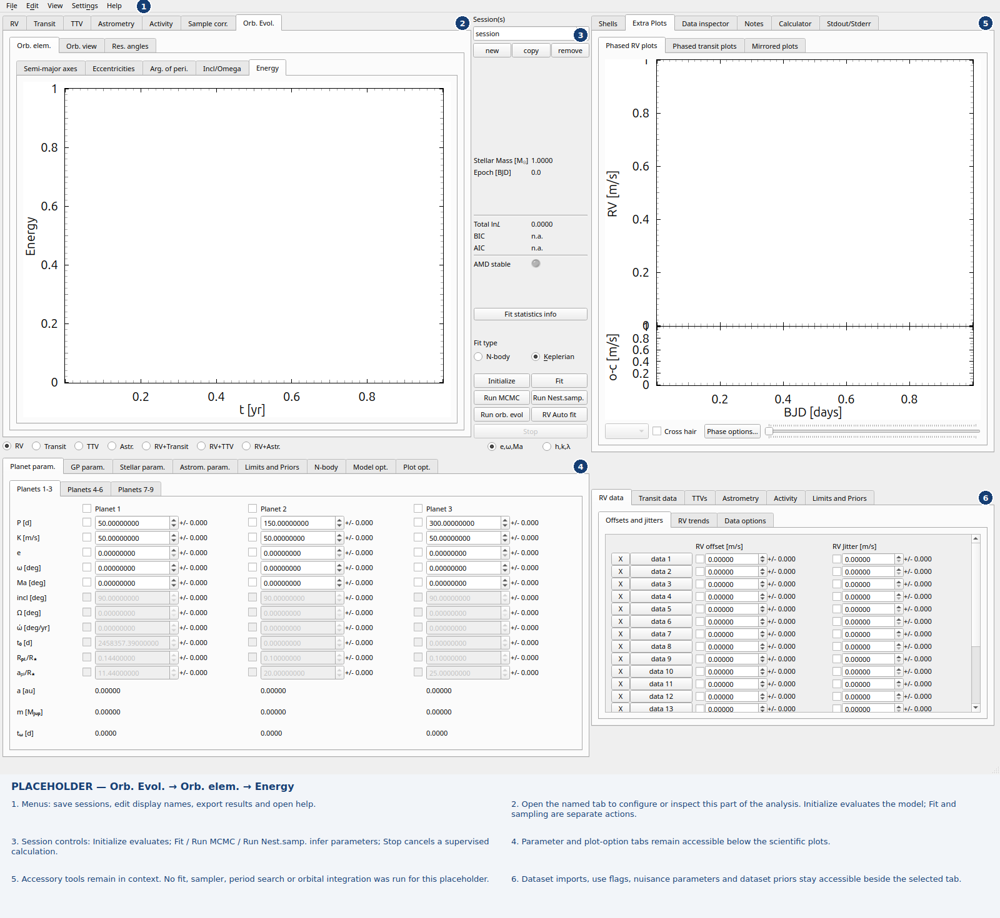

   Empty GUI placeholder, awaiting an author-provided real example. Open the named tab to configure or inspect this part of the analysis. Initialize evaluates the model; Fit and sampling are separate actions.

.. _gui-tab-tab_94:

Orb. Evol. → Res. angles → Period evol.
---------------------------------------

   Empty GUI placeholder, awaiting an author-provided real example. Open the named tab to configure or inspect this part of the analysis. Initialize evaluates the model; Fit and sampling are separate actions.

.. _gui-tab-tab_29:

Orb. Evol. → Res. angles → Delta omega
--------------------------------------

   Empty GUI placeholder, awaiting an author-provided real example. Open the named tab to configure or inspect this part of the analysis. Initialize evaluates the model; Fit and sampling are separate actions.

.. _gui-tab-tab_30:

Orb. Evol. → Res. angles → Res. angle (theta)
---------------------------------------------

   Empty GUI placeholder, awaiting an author-provided real example. Open the named tab to configure or inspect this part of the analysis. Initialize evaluates the model; Fit and sampling are separate actions.

