Bounds and prior tabs
=====================

See :doc:`tab-gallery` for the capture conventions and six numbered regions.

.. contents:: Open tabs
   :local:
   :depth: 1

.. _gui-tab-Limits_and_priors:

Limits and Priors
-----------------

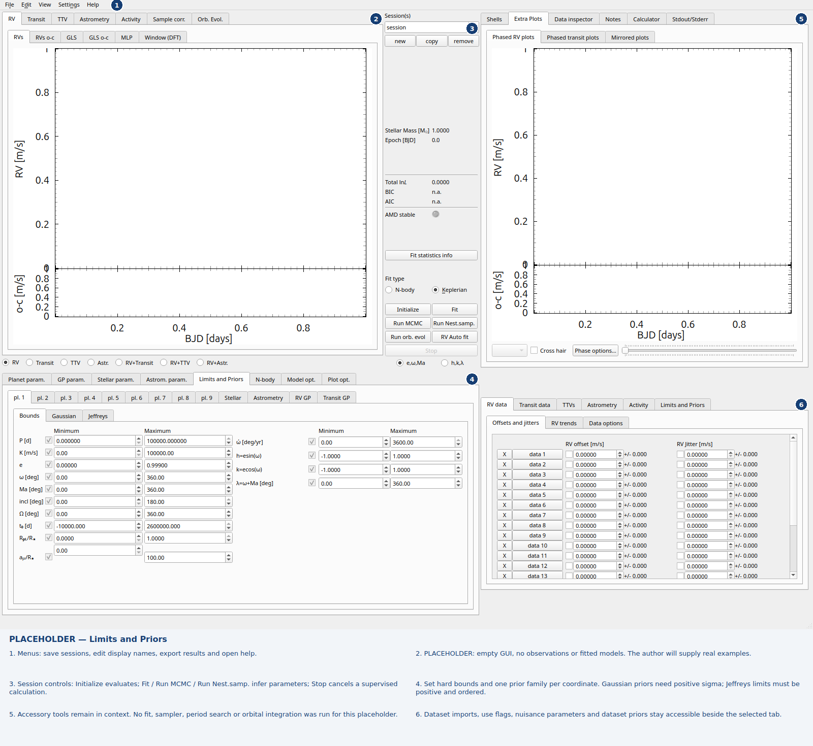

   Empty GUI placeholder, awaiting an author-provided real example. Set hard bounds and one prior family per coordinate. Gaussian priors need positive sigma; Jeffreys limits must be positive and ordered.

.. _gui-tab-tab_6:

Limits and Priors → pl. 1
-------------------------

   Empty GUI placeholder, awaiting an author-provided real example. Set hard bounds and one prior family per coordinate. Gaussian priors need positive sigma; Jeffreys limits must be positive and ordered.

.. _gui-tab-tab_15:

Limits and Priors → pl. 2
-------------------------

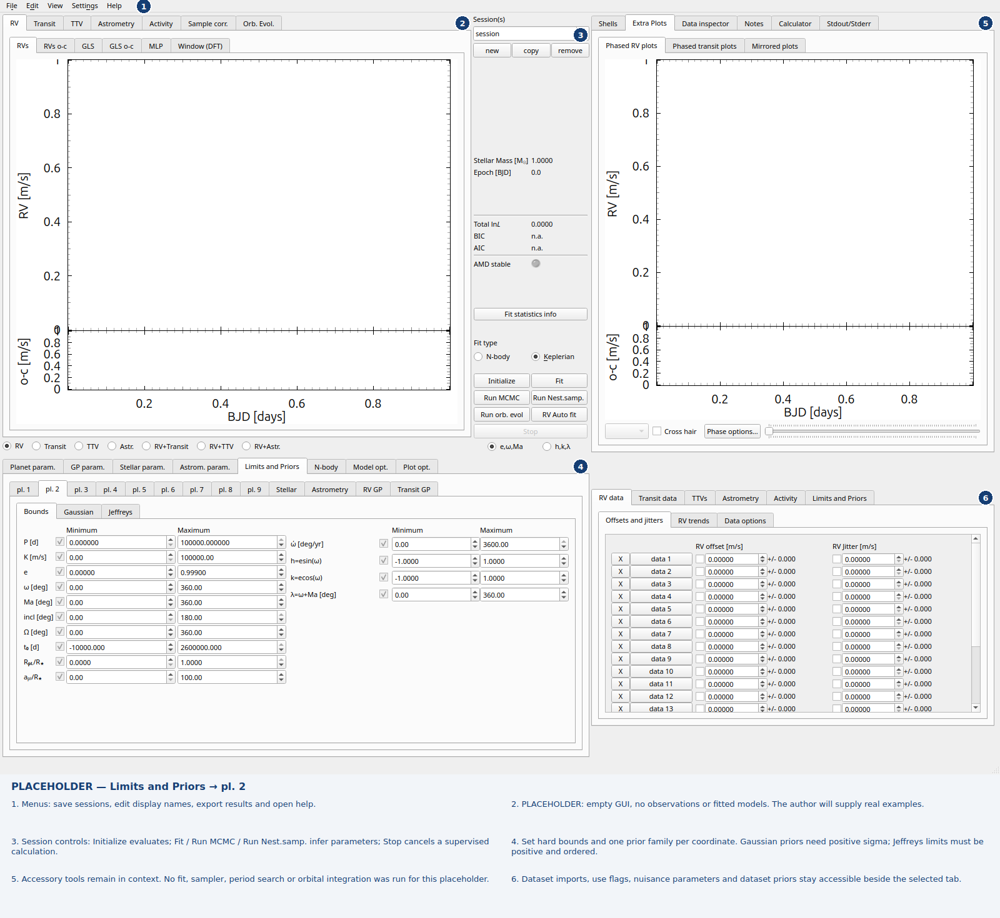

   Empty GUI placeholder, awaiting an author-provided real example. Set hard bounds and one prior family per coordinate. Gaussian priors need positive sigma; Jeffreys limits must be positive and ordered.

.. _gui-tab-tab:

Limits and Priors → pl. 3
-------------------------

   Empty GUI placeholder, awaiting an author-provided real example. Set hard bounds and one prior family per coordinate. Gaussian priors need positive sigma; Jeffreys limits must be positive and ordered.

.. _gui-tab-tab_5:

Limits and Priors → pl. 4
-------------------------

   Empty GUI placeholder, awaiting an author-provided real example. Set hard bounds and one prior family per coordinate. Gaussian priors need positive sigma; Jeffreys limits must be positive and ordered.

.. _gui-tab-tab_16:

Limits and Priors → pl. 5
-------------------------

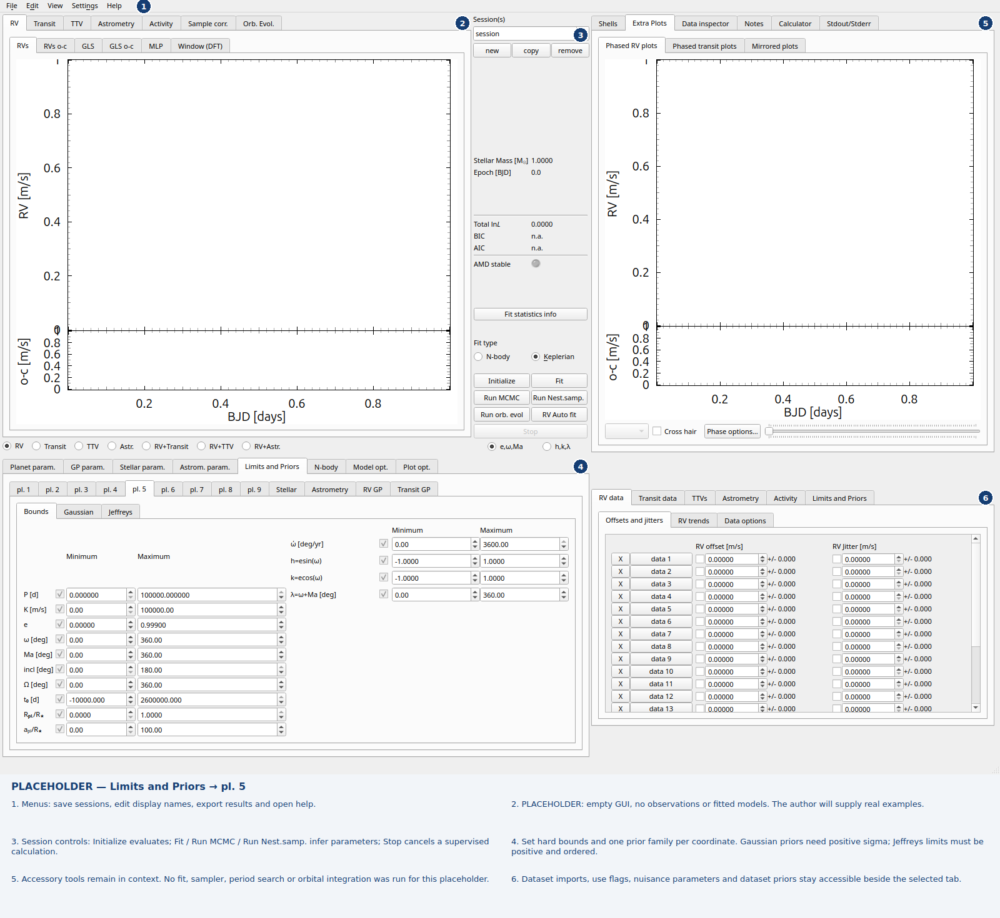

   Empty GUI placeholder, awaiting an author-provided real example. Set hard bounds and one prior family per coordinate. Gaussian priors need positive sigma; Jeffreys limits must be positive and ordered.

.. _gui-tab-tab_17:

Limits and Priors → pl. 6
-------------------------

   Empty GUI placeholder, awaiting an author-provided real example. Set hard bounds and one prior family per coordinate. Gaussian priors need positive sigma; Jeffreys limits must be positive and ordered.

.. _gui-tab-tab_18:

Limits and Priors → pl. 7
-------------------------

   Empty GUI placeholder, awaiting an author-provided real example. Set hard bounds and one prior family per coordinate. Gaussian priors need positive sigma; Jeffreys limits must be positive and ordered.

.. _gui-tab-tab_19:

Limits and Priors → pl. 8
-------------------------

   Empty GUI placeholder, awaiting an author-provided real example. Set hard bounds and one prior family per coordinate. Gaussian priors need positive sigma; Jeffreys limits must be positive and ordered.

.. _gui-tab-tab_34:

Limits and Priors → pl. 9
-------------------------

   Empty GUI placeholder, awaiting an author-provided real example. Set hard bounds and one prior family per coordinate. Gaussian priors need positive sigma; Jeffreys limits must be positive and ordered.

.. _gui-tab-tab_199:

Limits and Priors → Stellar
---------------------------

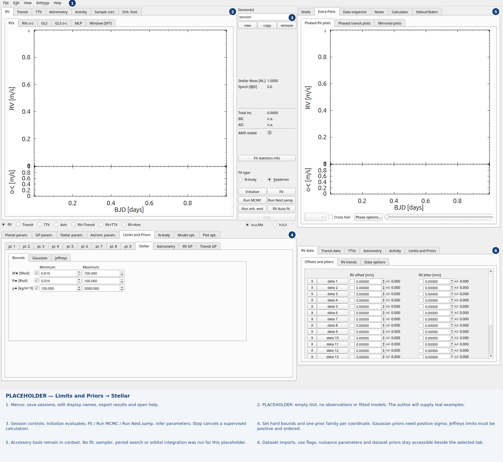

   Empty GUI placeholder, awaiting an author-provided real example. Set hard bounds and one prior family per coordinate. Gaussian priors need positive sigma; Jeffreys limits must be positive and ordered.

.. _gui-tab-tab_204:

Limits and Priors → Astrometry
------------------------------

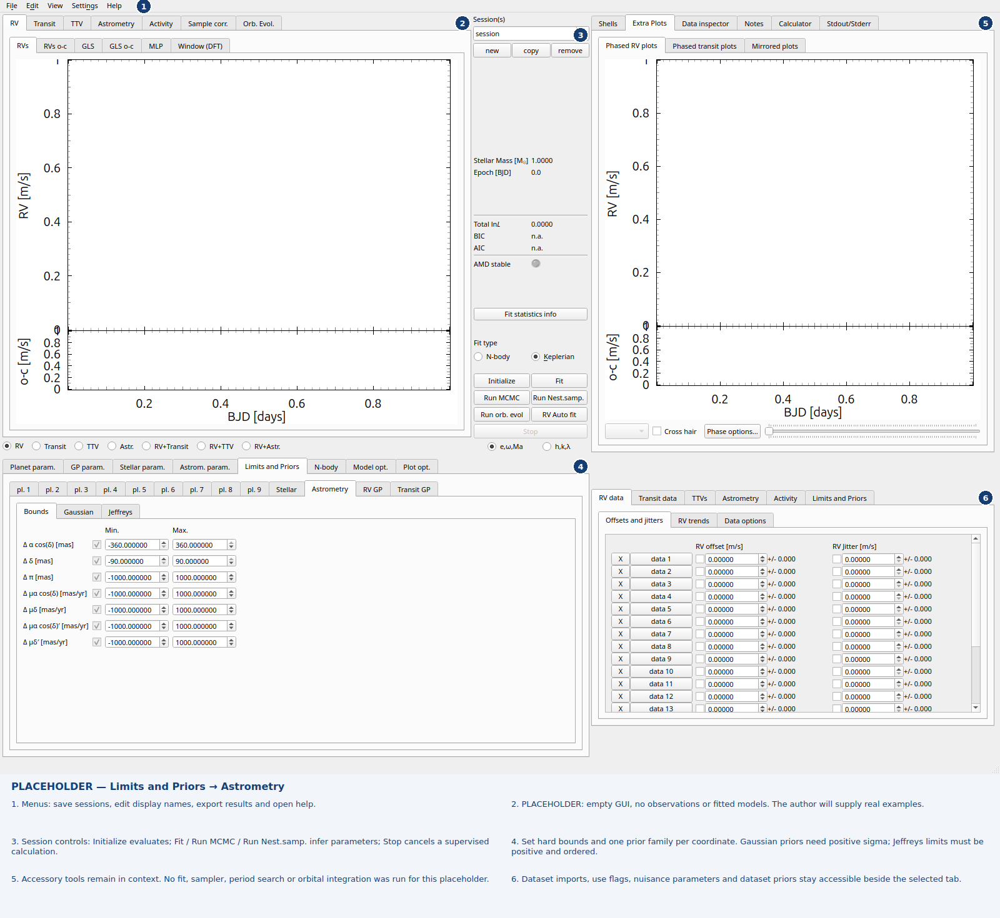

   Empty GUI placeholder, awaiting an author-provided real example. Set hard bounds and one prior family per coordinate. Gaussian priors need positive sigma; Jeffreys limits must be positive and ordered.

.. _gui-tab-tab_20:

Limits and Priors → RV GP
-------------------------

   Empty GUI placeholder, awaiting an author-provided real example. Set hard bounds and one prior family per coordinate. Gaussian priors need positive sigma; Jeffreys limits must be positive and ordered.

.. _gui-tab-tab_83:

Limits and Priors → Transit GP
------------------------------

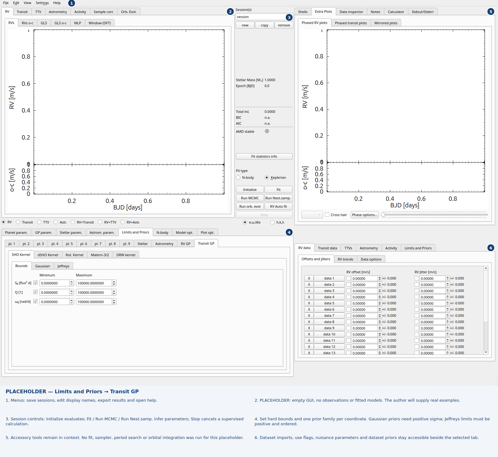

   Empty GUI placeholder, awaiting an author-provided real example. Set hard bounds and one prior family per coordinate. Gaussian priors need positive sigma; Jeffreys limits must be positive and ordered.

.. _gui-tab-tab_61:

Limits and Priors → pl. 1 → Bounds
----------------------------------

   Empty GUI placeholder, awaiting an author-provided real example. Set hard bounds and one prior family per coordinate. Gaussian priors need positive sigma; Jeffreys limits must be positive and ordered.

.. _gui-tab-tab_62:

Limits and Priors → pl. 1 → Gaussian
------------------------------------

   Empty GUI placeholder, awaiting an author-provided real example. Set hard bounds and one prior family per coordinate. Gaussian priors need positive sigma; Jeffreys limits must be positive and ordered.

.. _gui-tab-tab_97:

Limits and Priors → pl. 1 → Jeffreys
------------------------------------

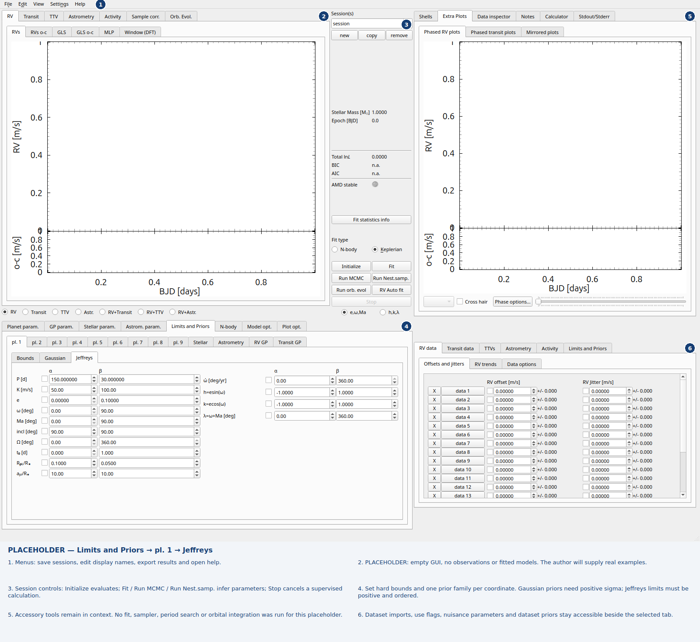

   Empty GUI placeholder, awaiting an author-provided real example. Set hard bounds and one prior family per coordinate. Gaussian priors need positive sigma; Jeffreys limits must be positive and ordered.

.. _gui-tab-tab_63:

Limits and Priors → pl. 2 → Bounds
----------------------------------

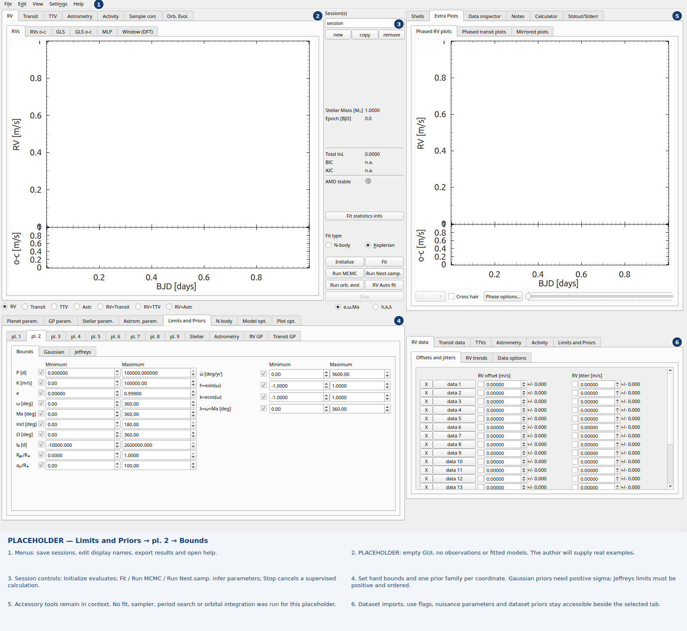

   Empty GUI placeholder, awaiting an author-provided real example. Set hard bounds and one prior family per coordinate. Gaussian priors need positive sigma; Jeffreys limits must be positive and ordered.

.. _gui-tab-tab_64:

Limits and Priors → pl. 2 → Gaussian
------------------------------------

   Empty GUI placeholder, awaiting an author-provided real example. Set hard bounds and one prior family per coordinate. Gaussian priors need positive sigma; Jeffreys limits must be positive and ordered.

.. _gui-tab-tab_98:

Limits and Priors → pl. 2 → Jeffreys
------------------------------------

   Empty GUI placeholder, awaiting an author-provided real example. Set hard bounds and one prior family per coordinate. Gaussian priors need positive sigma; Jeffreys limits must be positive and ordered.

.. _gui-tab-tab_65:

Limits and Priors → pl. 3 → Bounds
----------------------------------

   Empty GUI placeholder, awaiting an author-provided real example. Set hard bounds and one prior family per coordinate. Gaussian priors need positive sigma; Jeffreys limits must be positive and ordered.

.. _gui-tab-tab_66:

Limits and Priors → pl. 3 → Gaussian
------------------------------------

   Empty GUI placeholder, awaiting an author-provided real example. Set hard bounds and one prior family per coordinate. Gaussian priors need positive sigma; Jeffreys limits must be positive and ordered.

.. _gui-tab-tab_99:

Limits and Priors → pl. 3 → Jeffreys
------------------------------------

   Empty GUI placeholder, awaiting an author-provided real example. Set hard bounds and one prior family per coordinate. Gaussian priors need positive sigma; Jeffreys limits must be positive and ordered.

.. _gui-tab-tab_67:

Limits and Priors → pl. 4 → Bounds
----------------------------------

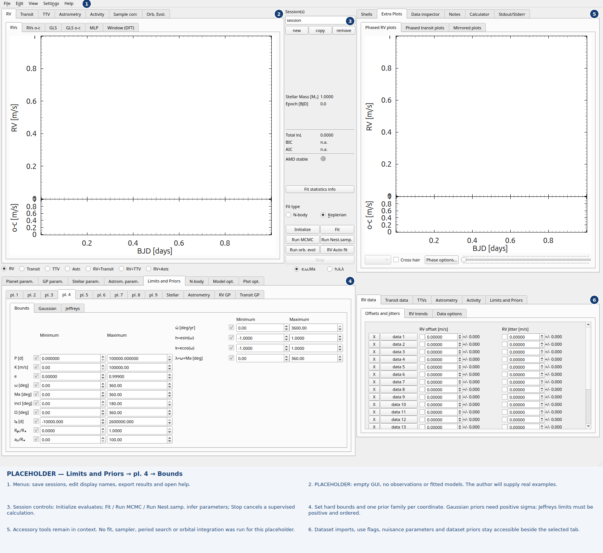

   Empty GUI placeholder, awaiting an author-provided real example. Set hard bounds and one prior family per coordinate. Gaussian priors need positive sigma; Jeffreys limits must be positive and ordered.

.. _gui-tab-tab_68:

Limits and Priors → pl. 4 → Gaussian
------------------------------------

   Empty GUI placeholder, awaiting an author-provided real example. Set hard bounds and one prior family per coordinate. Gaussian priors need positive sigma; Jeffreys limits must be positive and ordered.

.. _gui-tab-tab_100:

Limits and Priors → pl. 4 → Jeffreys
------------------------------------

   Empty GUI placeholder, awaiting an author-provided real example. Set hard bounds and one prior family per coordinate. Gaussian priors need positive sigma; Jeffreys limits must be positive and ordered.

.. _gui-tab-tab_69:

Limits and Priors → pl. 5 → Bounds
----------------------------------

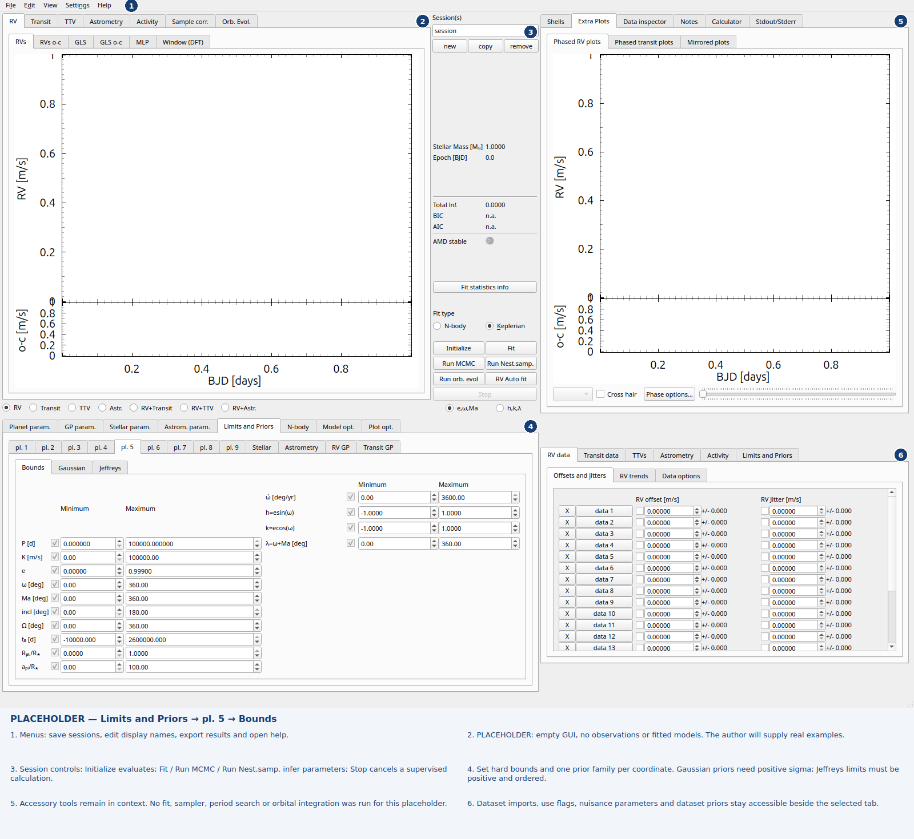

   Empty GUI placeholder, awaiting an author-provided real example. Set hard bounds and one prior family per coordinate. Gaussian priors need positive sigma; Jeffreys limits must be positive and ordered.

.. _gui-tab-tab_70:

Limits and Priors → pl. 5 → Gaussian
------------------------------------

   Empty GUI placeholder, awaiting an author-provided real example. Set hard bounds and one prior family per coordinate. Gaussian priors need positive sigma; Jeffreys limits must be positive and ordered.

.. _gui-tab-tab_107:

Limits and Priors → pl. 5 → Jeffreys
------------------------------------

   Empty GUI placeholder, awaiting an author-provided real example. Set hard bounds and one prior family per coordinate. Gaussian priors need positive sigma; Jeffreys limits must be positive and ordered.

.. _gui-tab-tab_71:

Limits and Priors → pl. 6 → Bounds
----------------------------------

   Empty GUI placeholder, awaiting an author-provided real example. Set hard bounds and one prior family per coordinate. Gaussian priors need positive sigma; Jeffreys limits must be positive and ordered.

.. _gui-tab-tab_72:

Limits and Priors → pl. 6 → Gaussian
------------------------------------

   Empty GUI placeholder, awaiting an author-provided real example. Set hard bounds and one prior family per coordinate. Gaussian priors need positive sigma; Jeffreys limits must be positive and ordered.

.. _gui-tab-tab_108:

Limits and Priors → pl. 6 → Jeffreys
------------------------------------

   Empty GUI placeholder, awaiting an author-provided real example. Set hard bounds and one prior family per coordinate. Gaussian priors need positive sigma; Jeffreys limits must be positive and ordered.

.. _gui-tab-tab_73:

Limits and Priors → pl. 7 → Bounds
----------------------------------

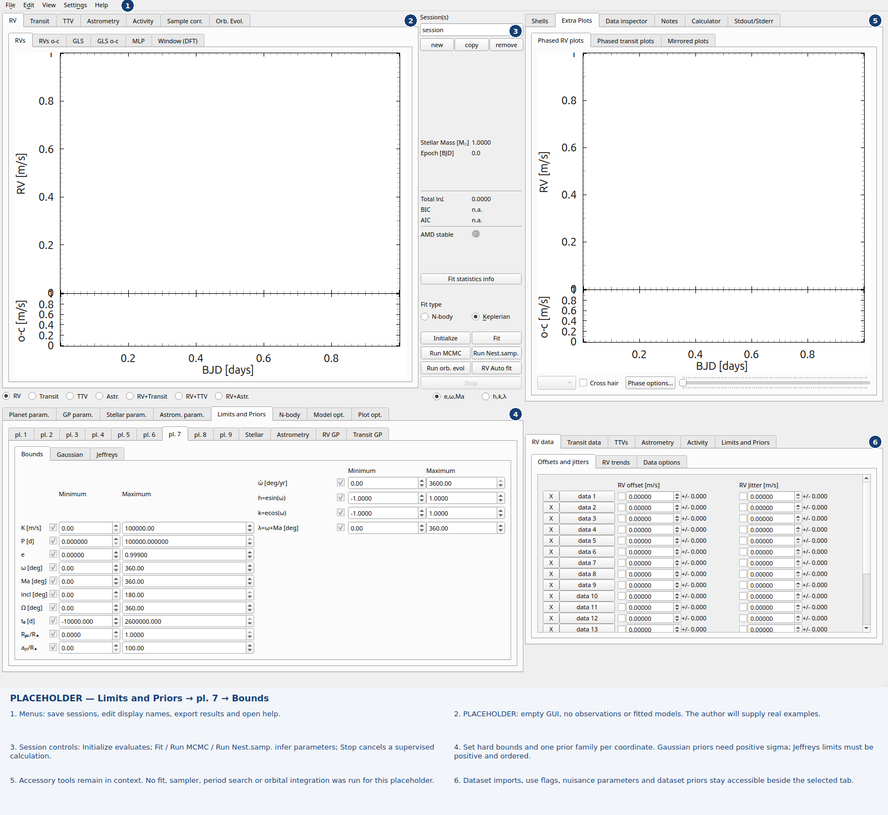

   Empty GUI placeholder, awaiting an author-provided real example. Set hard bounds and one prior family per coordinate. Gaussian priors need positive sigma; Jeffreys limits must be positive and ordered.

.. _gui-tab-tab_74:

Limits and Priors → pl. 7 → Gaussian
------------------------------------

   Empty GUI placeholder, awaiting an author-provided real example. Set hard bounds and one prior family per coordinate. Gaussian priors need positive sigma; Jeffreys limits must be positive and ordered.

.. _gui-tab-tab_109:

Limits and Priors → pl. 7 → Jeffreys
------------------------------------

   Empty GUI placeholder, awaiting an author-provided real example. Set hard bounds and one prior family per coordinate. Gaussian priors need positive sigma; Jeffreys limits must be positive and ordered.

.. _gui-tab-tab_75:

Limits and Priors → pl. 8 → Bounds
----------------------------------

   Empty GUI placeholder, awaiting an author-provided real example. Set hard bounds and one prior family per coordinate. Gaussian priors need positive sigma; Jeffreys limits must be positive and ordered.

.. _gui-tab-tab_76:

Limits and Priors → pl. 8 → Gaussian
------------------------------------

   Empty GUI placeholder, awaiting an author-provided real example. Set hard bounds and one prior family per coordinate. Gaussian priors need positive sigma; Jeffreys limits must be positive and ordered.

.. _gui-tab-tab_110:

Limits and Priors → pl. 8 → Jeffreys
------------------------------------

   Empty GUI placeholder, awaiting an author-provided real example. Set hard bounds and one prior family per coordinate. Gaussian priors need positive sigma; Jeffreys limits must be positive and ordered.

.. _gui-tab-tab_77:

Limits and Priors → pl. 9 → Bounds
----------------------------------

   Empty GUI placeholder, awaiting an author-provided real example. Set hard bounds and one prior family per coordinate. Gaussian priors need positive sigma; Jeffreys limits must be positive and ordered.

.. _gui-tab-tab_78:

Limits and Priors → pl. 9 → Gaussian
------------------------------------

   Empty GUI placeholder, awaiting an author-provided real example. Set hard bounds and one prior family per coordinate. Gaussian priors need positive sigma; Jeffreys limits must be positive and ordered.

.. _gui-tab-tab_111:

Limits and Priors → pl. 9 → Jeffreys
------------------------------------

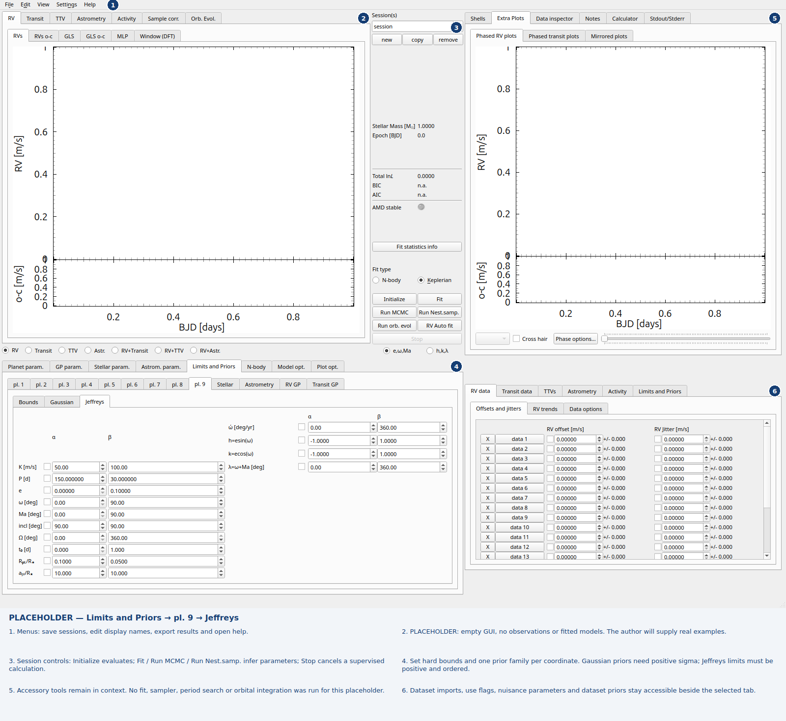

   Empty GUI placeholder, awaiting an author-provided real example. Set hard bounds and one prior family per coordinate. Gaussian priors need positive sigma; Jeffreys limits must be positive and ordered.

.. _gui-tab-tab_200:

Limits and Priors → Stellar → Bounds
------------------------------------

   Empty GUI placeholder, awaiting an author-provided real example. Set hard bounds and one prior family per coordinate. Gaussian priors need positive sigma; Jeffreys limits must be positive and ordered.

.. _gui-tab-tab_201:

Limits and Priors → Stellar → Gaussian
--------------------------------------

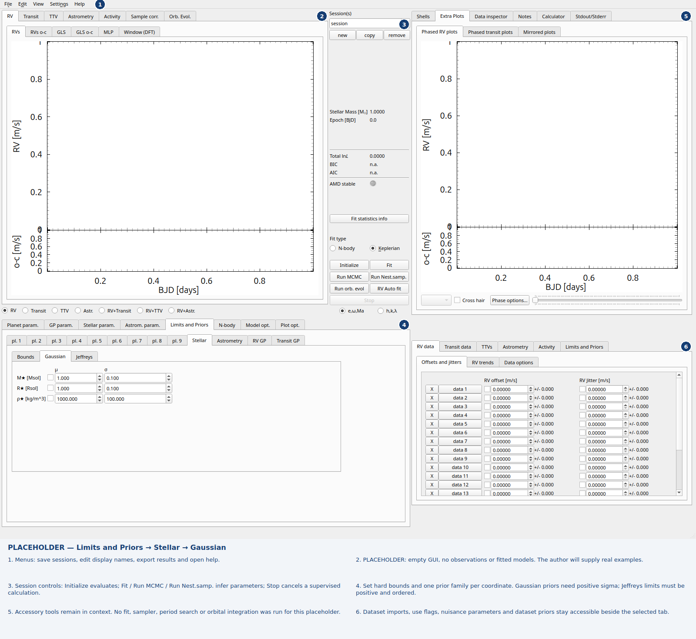

   Empty GUI placeholder, awaiting an author-provided real example. Set hard bounds and one prior family per coordinate. Gaussian priors need positive sigma; Jeffreys limits must be positive and ordered.

.. _gui-tab-tab_202:

Limits and Priors → Stellar → Jeffreys
--------------------------------------

   Empty GUI placeholder, awaiting an author-provided real example. Set hard bounds and one prior family per coordinate. Gaussian priors need positive sigma; Jeffreys limits must be positive and ordered.

.. _gui-tab-tab_194:

Limits and Priors → Astrometry → Bounds
---------------------------------------

   Empty GUI placeholder, awaiting an author-provided real example. Set hard bounds and one prior family per coordinate. Gaussian priors need positive sigma; Jeffreys limits must be positive and ordered.

.. _gui-tab-tab_195:

Limits and Priors → Astrometry → Gaussian
-----------------------------------------

   Empty GUI placeholder, awaiting an author-provided real example. Set hard bounds and one prior family per coordinate. Gaussian priors need positive sigma; Jeffreys limits must be positive and ordered.

.. _gui-tab-tab_196:

Limits and Priors → Astrometry → Jeffreys
-----------------------------------------

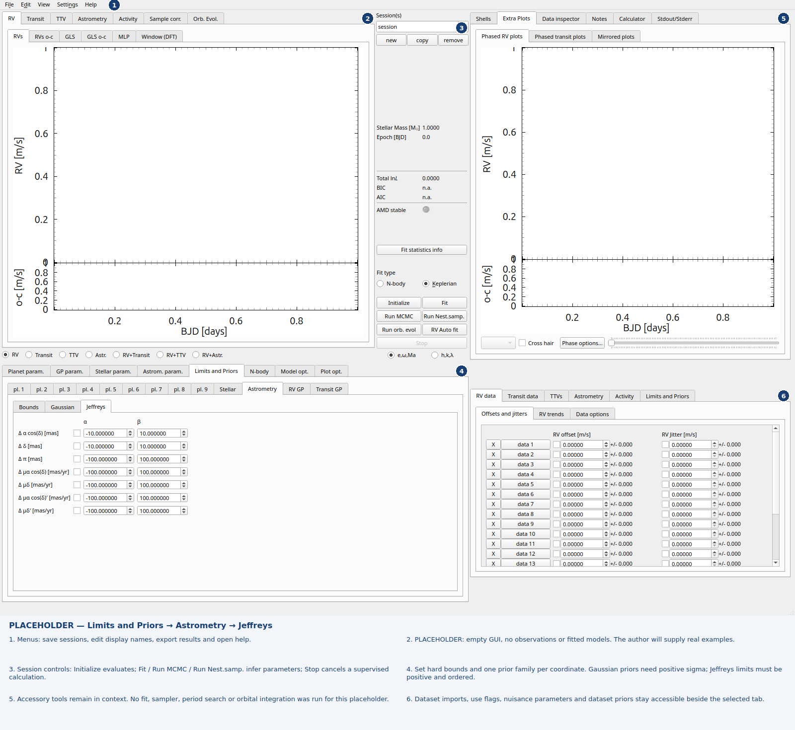

   Empty GUI placeholder, awaiting an author-provided real example. Set hard bounds and one prior family per coordinate. Gaussian priors need positive sigma; Jeffreys limits must be positive and ordered.

.. _gui-tab-tab_55:

Limits and Priors → RV GP → SHO Kernel
--------------------------------------

   Empty GUI placeholder, awaiting an author-provided real example. Set hard bounds and one prior family per coordinate. Gaussian priors need positive sigma; Jeffreys limits must be positive and ordered.

.. _gui-tab-tab_162:

Limits and Priors → RV GP → dSHO Kernel
---------------------------------------

   Empty GUI placeholder, awaiting an author-provided real example. Set hard bounds and one prior family per coordinate. Gaussian priors need positive sigma; Jeffreys limits must be positive and ordered.

.. _gui-tab-tab_51:

Limits and Priors → RV GP → Rot. Kernel
---------------------------------------

   Empty GUI placeholder, awaiting an author-provided real example. Set hard bounds and one prior family per coordinate. Gaussian priors need positive sigma; Jeffreys limits must be positive and ordered.

.. _gui-tab-tab_120:

Limits and Priors → RV GP → Matern-3/2
--------------------------------------

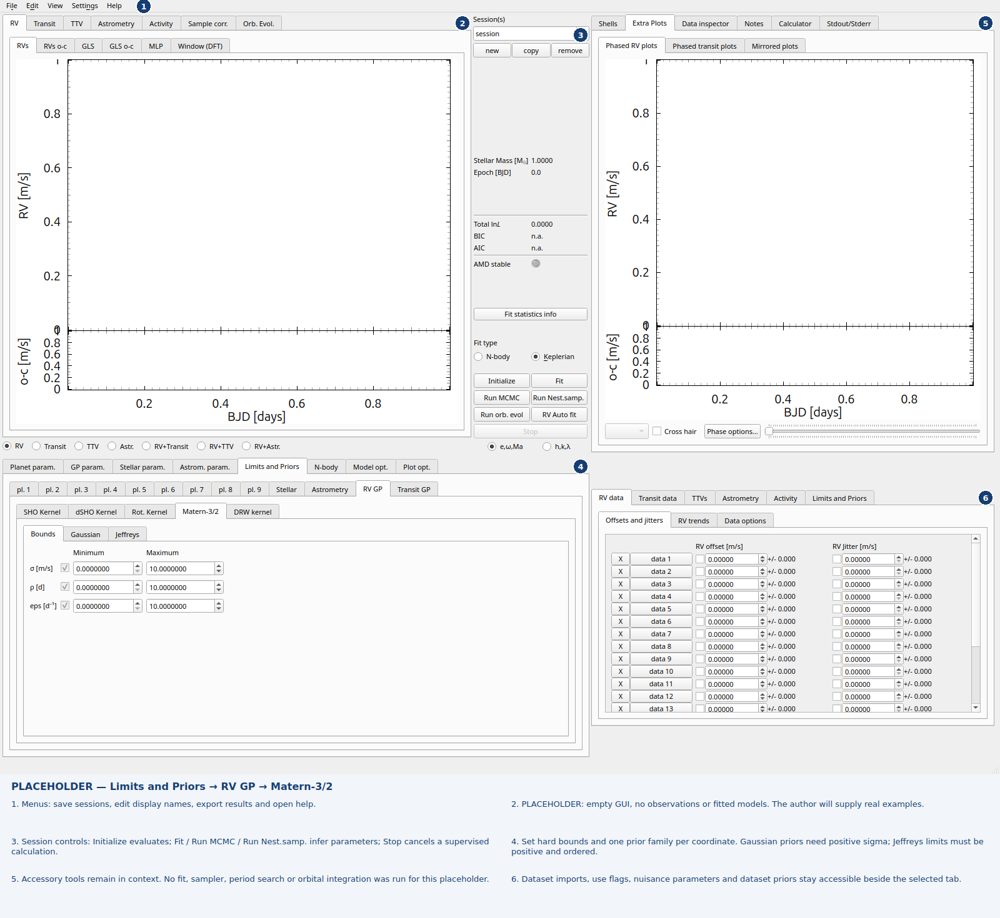

   Empty GUI placeholder, awaiting an author-provided real example. Set hard bounds and one prior family per coordinate. Gaussian priors need positive sigma; Jeffreys limits must be positive and ordered.

.. _gui-tab-tab_177:

Limits and Priors → RV GP → DRW kernel
--------------------------------------

   Empty GUI placeholder, awaiting an author-provided real example. Set hard bounds and one prior family per coordinate. Gaussian priors need positive sigma; Jeffreys limits must be positive and ordered.

.. _gui-tab-tab_58:

Limits and Priors → RV GP → SHO Kernel → Bounds
-----------------------------------------------

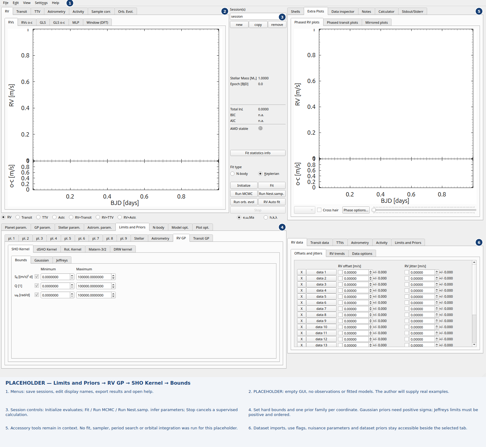

   Empty GUI placeholder, awaiting an author-provided real example. Set hard bounds and one prior family per coordinate. Gaussian priors need positive sigma; Jeffreys limits must be positive and ordered.

.. _gui-tab-tab_59:

Limits and Priors → RV GP → SHO Kernel → Gaussian
-------------------------------------------------

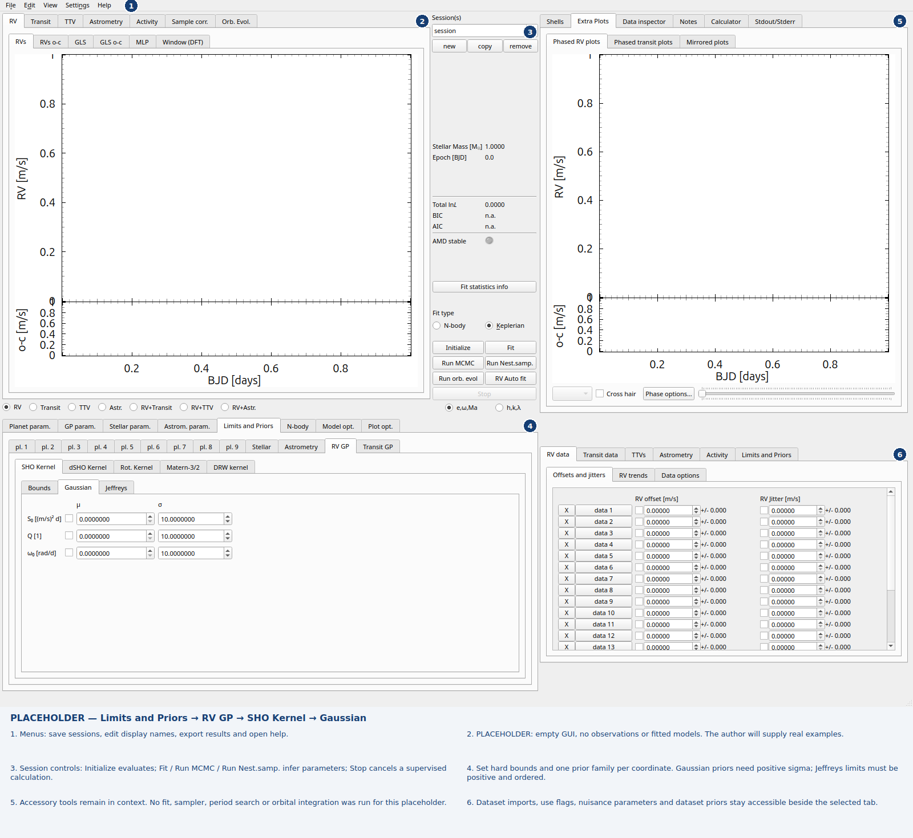

   Empty GUI placeholder, awaiting an author-provided real example. Set hard bounds and one prior family per coordinate. Gaussian priors need positive sigma; Jeffreys limits must be positive and ordered.

.. _gui-tab-tab_116:

Limits and Priors → RV GP → SHO Kernel → Jeffreys
-------------------------------------------------

   Empty GUI placeholder, awaiting an author-provided real example. Set hard bounds and one prior family per coordinate. Gaussian priors need positive sigma; Jeffreys limits must be positive and ordered.

.. _gui-tab-tab_163:

Limits and Priors → RV GP → dSHO Kernel → Bounds
------------------------------------------------

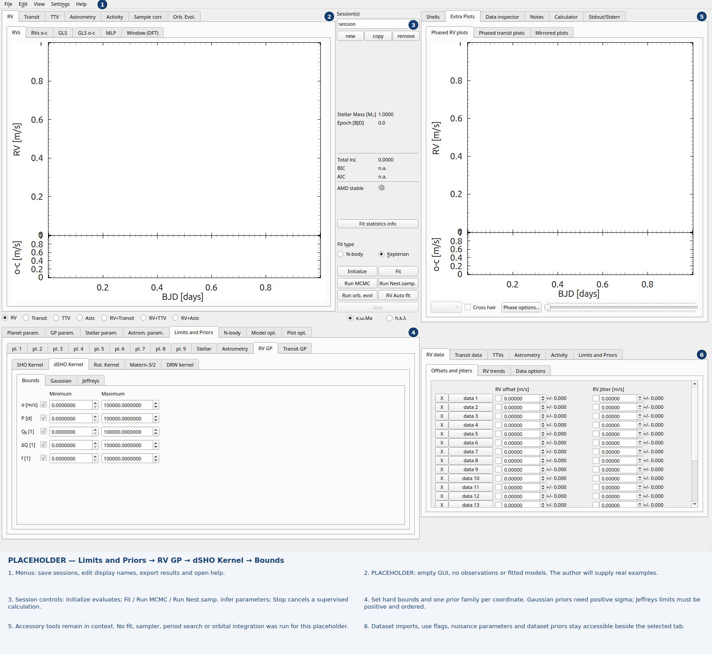

   Empty GUI placeholder, awaiting an author-provided real example. Set hard bounds and one prior family per coordinate. Gaussian priors need positive sigma; Jeffreys limits must be positive and ordered.

.. _gui-tab-tab_164:

Limits and Priors → RV GP → dSHO Kernel → Gaussian
--------------------------------------------------

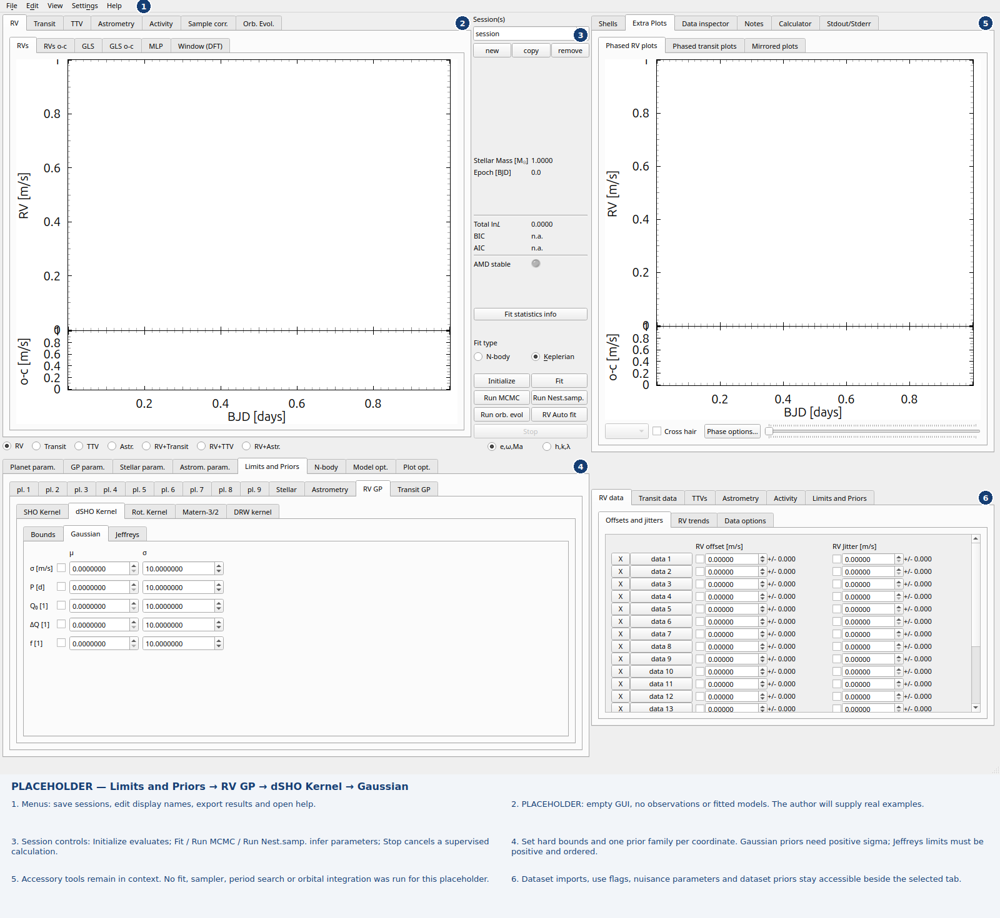

   Empty GUI placeholder, awaiting an author-provided real example. Set hard bounds and one prior family per coordinate. Gaussian priors need positive sigma; Jeffreys limits must be positive and ordered.

.. _gui-tab-tab_165:

Limits and Priors → RV GP → dSHO Kernel → Jeffreys
--------------------------------------------------

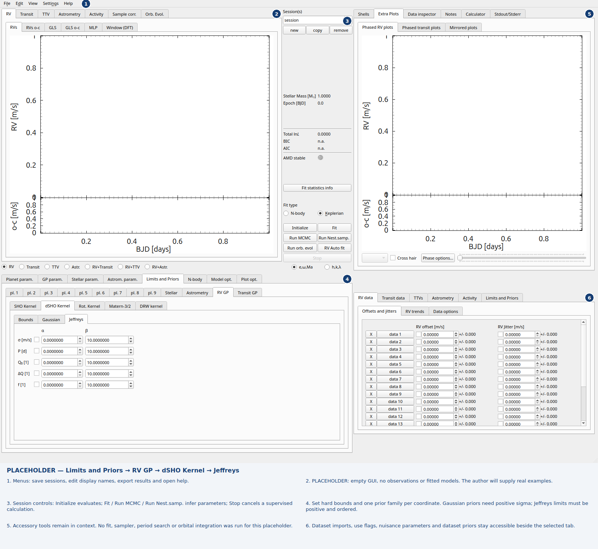

   Empty GUI placeholder, awaiting an author-provided real example. Set hard bounds and one prior family per coordinate. Gaussian priors need positive sigma; Jeffreys limits must be positive and ordered.

.. _gui-tab-tab_56:

Limits and Priors → RV GP → Rot. Kernel → Bounds
------------------------------------------------

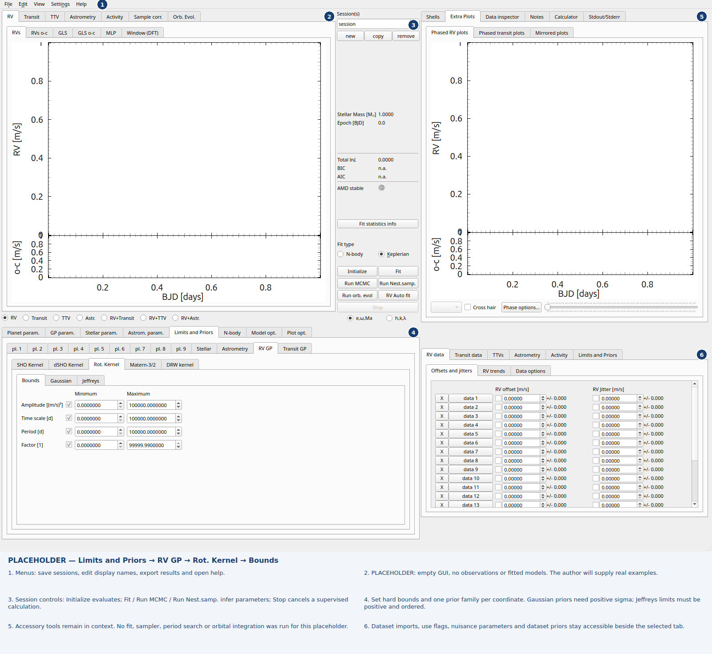

   Empty GUI placeholder, awaiting an author-provided real example. Set hard bounds and one prior family per coordinate. Gaussian priors need positive sigma; Jeffreys limits must be positive and ordered.

.. _gui-tab-tab_57:

Limits and Priors → RV GP → Rot. Kernel → Gaussian
--------------------------------------------------

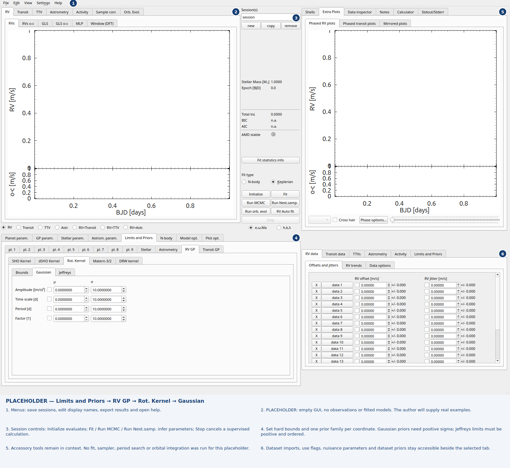

   Empty GUI placeholder, awaiting an author-provided real example. Set hard bounds and one prior family per coordinate. Gaussian priors need positive sigma; Jeffreys limits must be positive and ordered.

.. _gui-tab-tab_117:

Limits and Priors → RV GP → Rot. Kernel → Jeffreys
--------------------------------------------------

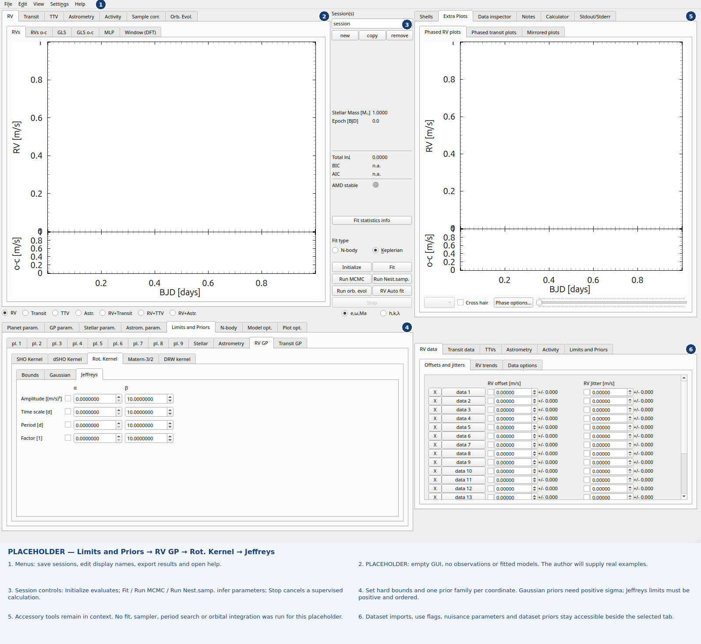

   Empty GUI placeholder, awaiting an author-provided real example. Set hard bounds and one prior family per coordinate. Gaussian priors need positive sigma; Jeffreys limits must be positive and ordered.

.. _gui-tab-tab_127:

Limits and Priors → RV GP → Matern-3/2 → Bounds
-----------------------------------------------

   Empty GUI placeholder, awaiting an author-provided real example. Set hard bounds and one prior family per coordinate. Gaussian priors need positive sigma; Jeffreys limits must be positive and ordered.

.. _gui-tab-tab_128:

Limits and Priors → RV GP → Matern-3/2 → Gaussian
-------------------------------------------------

   Empty GUI placeholder, awaiting an author-provided real example. Set hard bounds and one prior family per coordinate. Gaussian priors need positive sigma; Jeffreys limits must be positive and ordered.

.. _gui-tab-tab_129:

Limits and Priors → RV GP → Matern-3/2 → Jeffreys
-------------------------------------------------

   Empty GUI placeholder, awaiting an author-provided real example. Set hard bounds and one prior family per coordinate. Gaussian priors need positive sigma; Jeffreys limits must be positive and ordered.

.. _gui-tab-tab_178:

Limits and Priors → RV GP → DRW kernel → Bounds
-----------------------------------------------

   Empty GUI placeholder, awaiting an author-provided real example. Set hard bounds and one prior family per coordinate. Gaussian priors need positive sigma; Jeffreys limits must be positive and ordered.

.. _gui-tab-tab_179:

Limits and Priors → RV GP → DRW kernel → Gaussian
-------------------------------------------------

   Empty GUI placeholder, awaiting an author-provided real example. Set hard bounds and one prior family per coordinate. Gaussian priors need positive sigma; Jeffreys limits must be positive and ordered.

.. _gui-tab-tab_180:

Limits and Priors → RV GP → DRW kernel → Jeffreys
-------------------------------------------------

   Empty GUI placeholder, awaiting an author-provided real example. Set hard bounds and one prior family per coordinate. Gaussian priors need positive sigma; Jeffreys limits must be positive and ordered.

.. _gui-tab-tab_89:

Limits and Priors → Transit GP → SHO Kernel
-------------------------------------------

   Empty GUI placeholder, awaiting an author-provided real example. Set hard bounds and one prior family per coordinate. Gaussian priors need positive sigma; Jeffreys limits must be positive and ordered.

.. _gui-tab-tab_166:

Limits and Priors → Transit GP → dSHO Kernel
--------------------------------------------

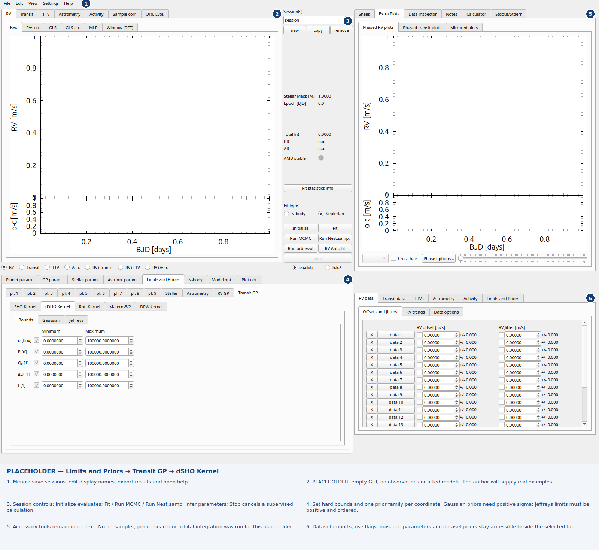

   Empty GUI placeholder, awaiting an author-provided real example. Set hard bounds and one prior family per coordinate. Gaussian priors need positive sigma; Jeffreys limits must be positive and ordered.

.. _gui-tab-tab_88:

Limits and Priors → Transit GP → Rot. Kernel
--------------------------------------------

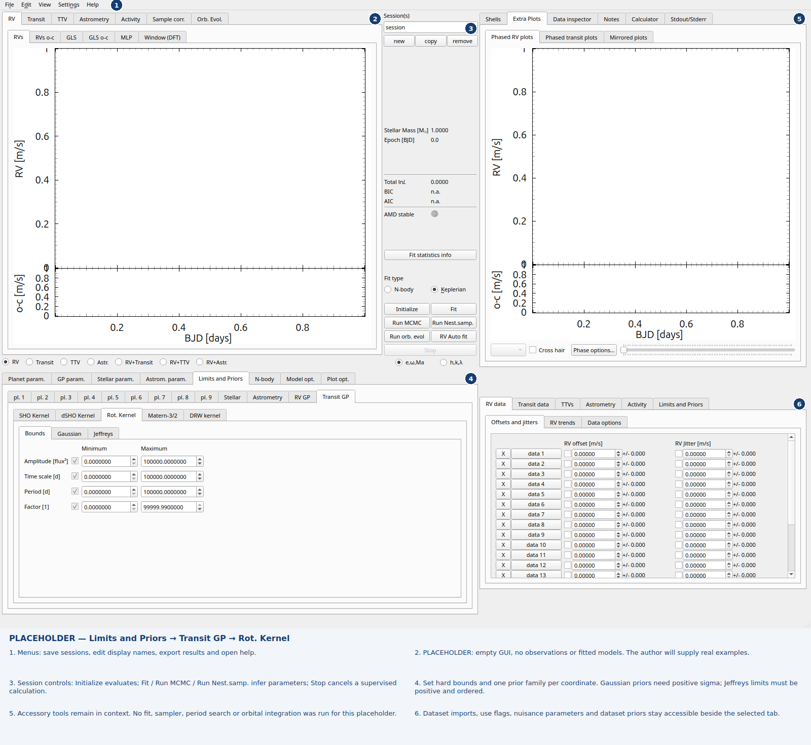

   Empty GUI placeholder, awaiting an author-provided real example. Set hard bounds and one prior family per coordinate. Gaussian priors need positive sigma; Jeffreys limits must be positive and ordered.

.. _gui-tab-tab_130:

Limits and Priors → Transit GP → Matern-3/2
-------------------------------------------

   Empty GUI placeholder, awaiting an author-provided real example. Set hard bounds and one prior family per coordinate. Gaussian priors need positive sigma; Jeffreys limits must be positive and ordered.

.. _gui-tab-tab_181:

Limits and Priors → Transit GP → DRW kernel
-------------------------------------------

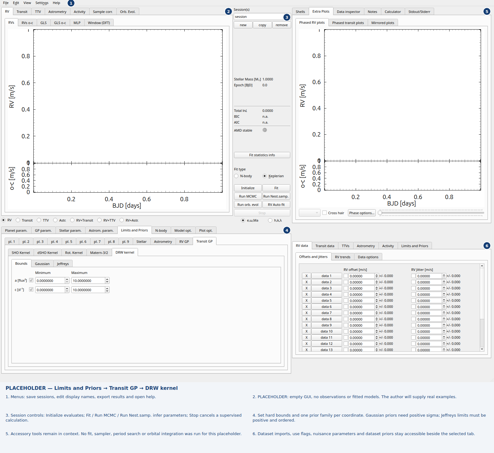

   Empty GUI placeholder, awaiting an author-provided real example. Set hard bounds and one prior family per coordinate. Gaussian priors need positive sigma; Jeffreys limits must be positive and ordered.

.. _gui-tab-tab_90:

Limits and Priors → Transit GP → SHO Kernel → Bounds
----------------------------------------------------

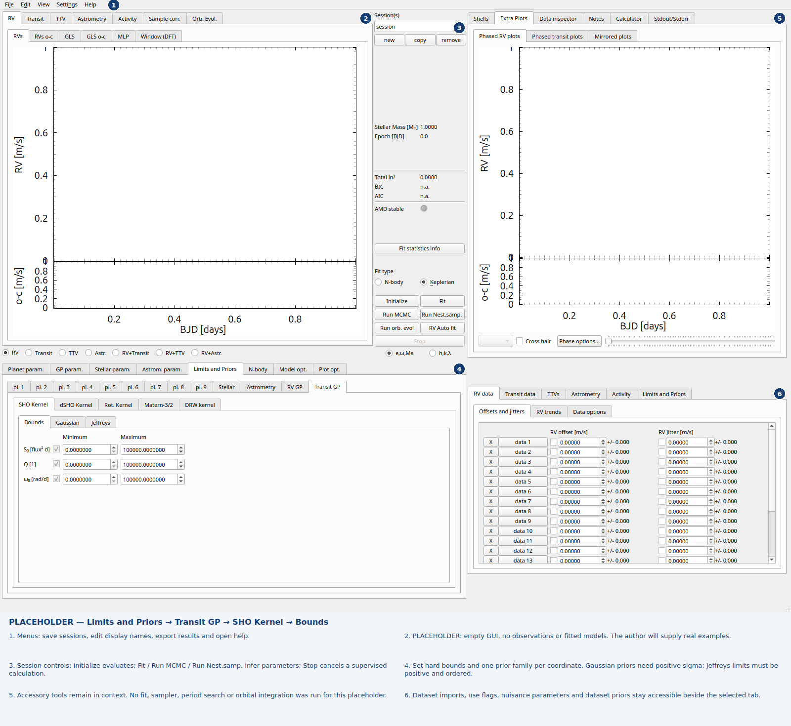

   Empty GUI placeholder, awaiting an author-provided real example. Set hard bounds and one prior family per coordinate. Gaussian priors need positive sigma; Jeffreys limits must be positive and ordered.

.. _gui-tab-tab_91:

Limits and Priors → Transit GP → SHO Kernel → Gaussian
------------------------------------------------------

   Empty GUI placeholder, awaiting an author-provided real example. Set hard bounds and one prior family per coordinate. Gaussian priors need positive sigma; Jeffreys limits must be positive and ordered.

.. _gui-tab-tab_95:

Limits and Priors → Transit GP → SHO Kernel → Jeffreys
------------------------------------------------------

   Empty GUI placeholder, awaiting an author-provided real example. Set hard bounds and one prior family per coordinate. Gaussian priors need positive sigma; Jeffreys limits must be positive and ordered.

.. _gui-tab-tab_167:

Limits and Priors → Transit GP → dSHO Kernel → Bounds
-----------------------------------------------------

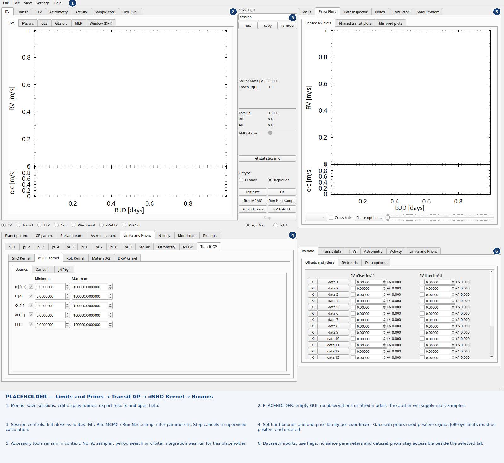

   Empty GUI placeholder, awaiting an author-provided real example. Set hard bounds and one prior family per coordinate. Gaussian priors need positive sigma; Jeffreys limits must be positive and ordered.

.. _gui-tab-tab_168:

Limits and Priors → Transit GP → dSHO Kernel → Gaussian
-------------------------------------------------------

   Empty GUI placeholder, awaiting an author-provided real example. Set hard bounds and one prior family per coordinate. Gaussian priors need positive sigma; Jeffreys limits must be positive and ordered.

.. _gui-tab-tab_169:

Limits and Priors → Transit GP → dSHO Kernel → Jeffreys
-------------------------------------------------------

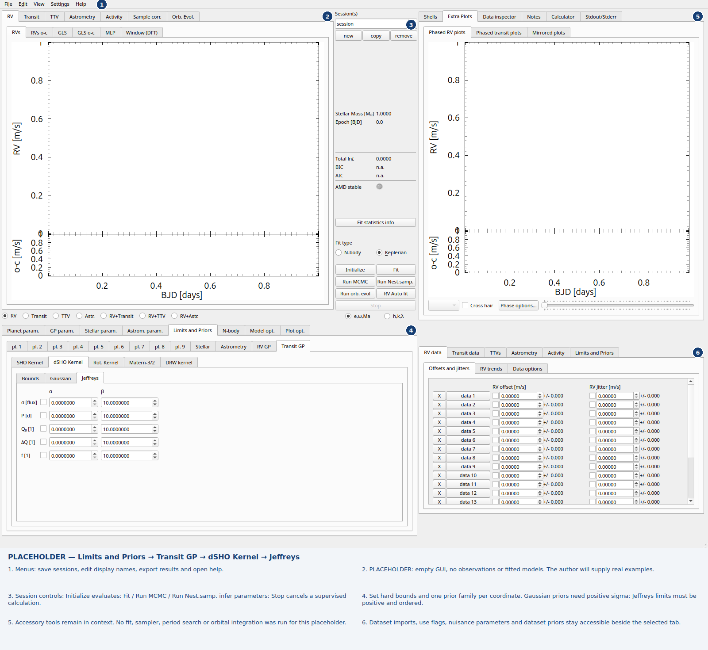

   Empty GUI placeholder, awaiting an author-provided real example. Set hard bounds and one prior family per coordinate. Gaussian priors need positive sigma; Jeffreys limits must be positive and ordered.

.. _gui-tab-tab_146:

Limits and Priors → Transit GP → Rot. Kernel → Bounds
-----------------------------------------------------

   Empty GUI placeholder, awaiting an author-provided real example. Set hard bounds and one prior family per coordinate. Gaussian priors need positive sigma; Jeffreys limits must be positive and ordered.

.. _gui-tab-tab_147:

Limits and Priors → Transit GP → Rot. Kernel → Gaussian
-------------------------------------------------------

   Empty GUI placeholder, awaiting an author-provided real example. Set hard bounds and one prior family per coordinate. Gaussian priors need positive sigma; Jeffreys limits must be positive and ordered.

.. _gui-tab-tab_148:

Limits and Priors → Transit GP → Rot. Kernel → Jeffreys
-------------------------------------------------------

   Empty GUI placeholder, awaiting an author-provided real example. Set hard bounds and one prior family per coordinate. Gaussian priors need positive sigma; Jeffreys limits must be positive and ordered.

.. _gui-tab-tab_131:

Limits and Priors → Transit GP → Matern-3/2 → Bounds
----------------------------------------------------

   Empty GUI placeholder, awaiting an author-provided real example. Set hard bounds and one prior family per coordinate. Gaussian priors need positive sigma; Jeffreys limits must be positive and ordered.

.. _gui-tab-tab_132:

Limits and Priors → Transit GP → Matern-3/2 → Gaussian
------------------------------------------------------

   Empty GUI placeholder, awaiting an author-provided real example. Set hard bounds and one prior family per coordinate. Gaussian priors need positive sigma; Jeffreys limits must be positive and ordered.

.. _gui-tab-tab_133:

Limits and Priors → Transit GP → Matern-3/2 → Jeffreys
------------------------------------------------------

   Empty GUI placeholder, awaiting an author-provided real example. Set hard bounds and one prior family per coordinate. Gaussian priors need positive sigma; Jeffreys limits must be positive and ordered.

.. _gui-tab-tab_182:

Limits and Priors → Transit GP → DRW kernel → Bounds
----------------------------------------------------

   Empty GUI placeholder, awaiting an author-provided real example. Set hard bounds and one prior family per coordinate. Gaussian priors need positive sigma; Jeffreys limits must be positive and ordered.

.. _gui-tab-tab_183:

Limits and Priors → Transit GP → DRW kernel → Gaussian
------------------------------------------------------

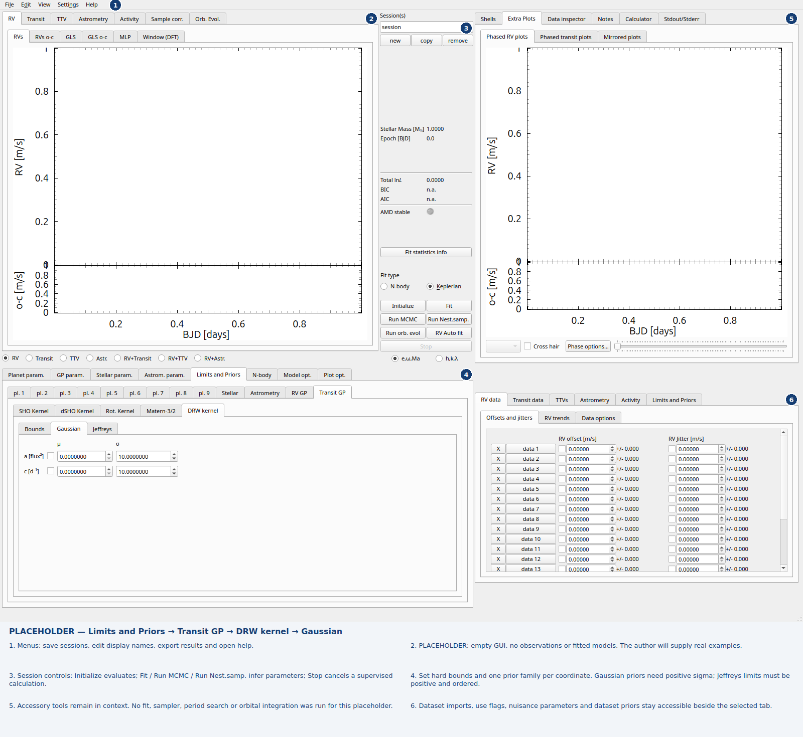

   Empty GUI placeholder, awaiting an author-provided real example. Set hard bounds and one prior family per coordinate. Gaussian priors need positive sigma; Jeffreys limits must be positive and ordered.

.. _gui-tab-tab_184:

Limits and Priors → Transit GP → DRW kernel → Jeffreys
------------------------------------------------------

   Empty GUI placeholder, awaiting an author-provided real example. Set hard bounds and one prior family per coordinate. Gaussian priors need positive sigma; Jeffreys limits must be positive and ordered.

